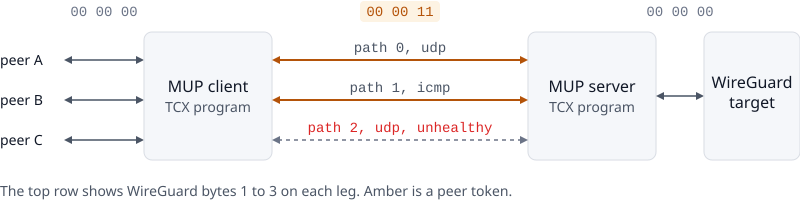
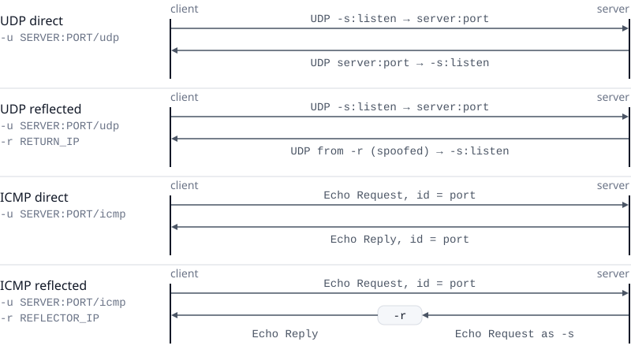
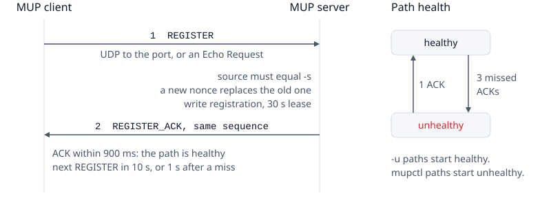
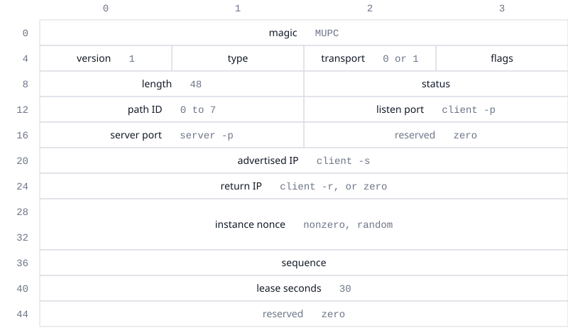

# MUP protocol

This document describes version 1 of the MUP protocol as the code implements it. It covers the packet formats, the control plane, the BPF maps, and the timers.

## Contents

1. [Terms](#terms)
2. [Topology](#topology)
3. [The peer token](#the-peer-token)
4. [Packet rewrites](#packet-rewrites)
5. [Transports and return modes](#transports-and-return-modes)
6. [Packet flow](#packet-flow)
7. [Path selection](#path-selection)
8. [Control plane](#control-plane)
9. [Path health](#path-health)
10. [Dataplane state](#dataplane-state)
11. [Lifetimes and cleanup](#lifetimes-and-cleanup)
12. [Input rules](#input-rules)
13. [Drop reasons](#drop-reasons)
14. [Attachment and restarts](#attachment-and-restarts)
15. [Observability](#observability)
16. [Control socket](#control-socket)
17. [Trust model](#trust-model)
18. [Limits](#limits)

## Terms

| Term | Meaning |
| --- | --- |
| WireGuard peer | A WireGuard endpoint that sends its packets to the MUP client. |
| WireGuard target | The one WireGuard endpoint behind the MUP server. The server `-r` flag sets it. |
| Path | One way from the client to a server. One client `-u` flag sets one path. |
| Up path | A path of a group with separate down paths. It carries only the packets from the client to the server. |
| Down path | A way that the server sends the replies of a group to the client. One `downstream` route sets one down path. |
| Bridge | A host that runs `mup bridge` between the clients and one server. One `bridges` entry sets one up path or down path through it. |
| Bridge wrapper | The 20 bytes that a server puts after the IPv4 header of a reply for a bridge: a UDP header and the bridge header. |
| Group | One listen port with its mode and its paths. Each path has an optional return IP. |
| Port | The number in `-u SERVER:PORT` and in server `-p`. For UDP, it is the destination port. For ICMP, it is the Echo identifier. |
| Listen port | The client `-p` port of a group. The peers send to it, and downstream packets arrive on it. |
| Advertised IP | The client address in client `-s`. The server sends all replies to it. |
| Return IP | The optional client `-r` address of a group. For UDP, it is the spoofed source of replies. For ICMP, it is the reflector. |
| Peer token | A client-local number from 1 to 4095 that names one WireGuard peer. |
| Instance nonce | A random nonzero 64-bit number that a client picks at each start. |
| Client key | The advertised IP and the instance nonce together. The server uses it to tell clients apart. |
| Route | The state that joins one peer to its token, or one token to its target port. |
| Target port | A UDP source port from 20000 to 60999 that the server gives to one route. |
| Lease | The time that a registration stays valid without a new REGISTER frame. |
| Quarantine | A wait time before a free token or port goes back into use. |
| `TCX_NEXT` | The TCX verdict that passes a packet on to the kernel without a change. |

## Topology

<picture>
  <source media="(prefers-color-scheme: dark)" srcset=".docs/images/overview-dark.svg">
  
</picture>

One MUP server serves many MUP clients. Each client serves many WireGuard peers and uses up to eight paths in all. Each server forwards all traffic to one WireGuard target. Each active client of a server must use an advertised IP that no other client of that server uses.

MUP has three ingress programs. `mup_client_ingress` runs on the client host, `mup_server_ingress` runs on the server host, and `mup_bridge_ingress` runs on a bridge host. Each program attaches to the TCX ingress hook of every Ethernet interface that is up at start. The loopback interface counts as an Ethernet interface. For a packet that MUP does not own, the program returns `TCX_NEXT`, and the kernel handles the packet as usual.

### Path groups

<picture>
  <source media="(prefers-color-scheme: dark)" srcset=".docs/images/groups-dark.svg">
  
</picture>

A client can serve several WireGuard targets, with one group for each. A group joins one listen port to a mode and a set of paths, and each path has an optional return IP. The port that a peer sends to selects its group. All servers of a group must forward to the same target, because a WireGuard handshake fails against another identity.

The groups share the advertised IP, the instance nonce, the eight path slots, and the pool of tokens. A token is unique in the client, so a downstream token gives the peer and its group. The client never moves a peer to another group.

The client configuration rejects one server address and port in two groups. The server keeps one listen port for each client key. Two groups on one server thus overwrite this value. The server keeps the return IP of each registered path.

## The peer token

<picture>
  <source media="(prefers-color-scheme: dark)" srcset=".docs/images/packet-dark.svg">
  
</picture>

A WireGuard message starts with a type byte and three reserved bytes. WireGuard sends the reserved bytes as zero. MUP uses them for the peer token while the packet travels between the MUP client and the MUP server. The token is a 24-bit big-endian number. Protocol v1 uses only the values 1 to 4095 and treats all other values as invalid.

The client keeps one token for each peer endpoint. A peer endpoint is the peer IP and port, the local IP, and the listen port. The server keys its routes by the client key and the token together, so two clients can use the same token. The token bytes are zero again before a WireGuard implementation reads the packet. WireGuard authentication and the handshake MACs thus stay valid.

## Packet rewrites

MUP rewrites every packet in place, as the hexdump in the previous section shows. A rewrite changes the IPv4 addresses, the IPv4 protocol field, all eight bytes of the UDP or ICMP header, and the peer token. UDP and ICMP headers are both eight bytes long. A packet can thus switch between UDP and ICMP without a change in length. The IPv4 total length, the TTL, the DF bit, and the WireGuard payload stay the same.

### Checksums

MUP computes the IPv4 header checksum again over the 20 header bytes. It updates the UDP or ICMP checksum incrementally, as RFC 1624 describes. The formula is `HC' = ~(~HC + ~m + m')`, where `m` holds the old words and `m'` holds the new words. First, it derives the sum of the payload from the old checksum and the old header words. Then it adds the new header words and writes the new checksum. The cost is the same for every packet size. MUP reads the payload bytes in only two cases, which the next paragraphs describe: a UDP checksum of zero and a partial checksum on an ICMP path.

A valid checksum stays valid after a rewrite, and a corrupt checksum stays corrupt. The receiver then drops the corrupt packet as usual. The UDP checksum covers the UDP pseudo-header, and the ICMP checksum does not. A computed UDP checksum of zero goes on the wire as 0xffff, as RFC 768 requires.

A UDP checksum field of zero gives no payload sum to update. IPv4 lets a sender that computes no checksum send zero. Some NAT devices also write zero for a computed checksum of zero, where RFC 768 requires 0xffff. About 1 packet in 65536 of their flows then arrives with zero, and plain WireGuard accepts it as a packet without a checksum. So MUP sums the payload of such a packet, up to 9216 bytes, writes its checksum, and then rewrites it as usual. If the payload is longer, MUP drops the packet and counts reason 20.

A target on the server host, for example `127.0.0.1`, answers from a local socket. Its replies have a partial checksum (`CHECKSUM_PARTIAL`): the UDP checksum field holds only the pseudo-header sum, and the network device adds the UDP header and the payload at send time. If the target IP equals the source IP of the target route, the server handles the target as local. The target can use any address of the server host, and the server reaches it through the loopback interface. On a UDP path, the server writes the new pseudo-header sum and leaves the rest to the device. On an ICMP path, the server computes the ICMP checksum from the payload and keeps the sequence at zero. It does not leave this checksum to the device, because some devices, for example vmxnet3, do not complete the partial checksum of an ICMP packet. A device that completes it writes a word at the UDP checksum offset, which is the Echo sequence field. If all words add up to 0xffff, a one's complement checksum is valid, so this word keeps the checksum valid. The client does not read the sequence, because the peer token is in the WireGuard bytes. The client does the same for a packet from WireGuard on the client host. That packet also comes through loopback with a partial checksum.

`protocol/rewrite.go` is a copy of the algorithm in `bpf/include/rewrite.h`. Its tests make sure that each incremental result matches a full checksum of the packet.

## Transports and return modes

<picture>
  <source media="(prefers-color-scheme: dark)" srcset=".docs/images/return-modes-dark.svg">
  
</picture>

Each path uses UDP or ICMP. The return IP of a path sets the return mode of that path. The table shows the outer headers of each packet. In the table, "listen" is the listen port, "port" is the port of the path, and "token" is the peer token.

| Direction | Mode | Source | Destination | Transport header |
| --- | --- | --- | --- | --- |
| Upstream | UDP | `-s`:listen | server:port | UDP |
| Upstream | ICMP | `-s` | server | Echo Request, identifier = port, sequence = token |
| Downstream | UDP direct | server:port | `-s`:listen | UDP |
| Downstream | UDP reflected | return IP:port | `-s`:listen | UDP with a spoofed source |
| Downstream | ICMP direct | server | `-s` | Echo Reply, identifier = port, sequence = token |
| Downstream | ICMP reflected | `-s` | return IP | Echo Request, identifier = port, sequence = token |

In a downstream packet, "server" is the server address that received the latest upstream packet of the route.

In the UDP reflected mode, the return IP host never receives the packet. The server only writes the return IP as the source. The networks between the server and the client must accept a spoofed source. A network that filters source addresses (BCP 38) drops these packets.

In the ICMP reflected mode, the server sends an Echo Request from `-s` to the reflector. The reflector answers with an Echo Reply to `-s`, which is the client. Any host that answers ping can be the reflector. The network between the server and the reflector must accept the spoofed source. The server sends the Echo Request out of the interface that received the traffic of the path. So the reflector must be reachable through that interface.

The client accepts a downstream packet only from a source that a path of the group of the peer expects. The packet must also have the port and the transport of that path. If the path has a return IP, the source must equal it. If the path has a return pool, the source must be in the pool range. If the path has neither, the source must be the server address of the path. The client drops any other downstream packet and counts reason 22.

### Return pools

A return pool is a range of return IPs, for example `via 94.184.45.48/28`. The base must be the network address of the range.

The server picks one member of the pool for each downstream packet. In the per-peer balance mode, all packets of one peer use one member. In the per-packet mode, each packet uses the next member. A pool has at most 16 members, and only a healthy member carries packets. If a pool has no healthy member, the server drops the packet and counts reason 15.

Every 2 seconds, the server sends one Echo Request to each host address of each pool range, up to 1024 addresses in each range. A /31 has two host addresses. In a larger range, the network address and the broadcast address are not host addresses. A host that replies within 1 second is live.

- An ICMP member must reply to ping, because it sends the Echo Reply to the client. The members are the live hosts. A member that misses 3 sweeps in a row is unhealthy, and a member that misses 15 sweeps leaves the pool.
- A UDP member is only a spoofed source, so it does not have to reply to ping. The members are the live hosts first, then the other hosts of the range in order. Every 2 seconds, the server sends a control probe to the client from each member as a spoofed source. The client sends a probe reply to the real server for each probe that arrives. A UDP member is healthy for 6 seconds after its latest probe reply.

If no member of a pool is healthy, the server answers each REGISTER of a path with that pool with the status NO_REFLECTOR. It still registers the path, so the path comes back once a reflector is healthy. A new pool is ready for 6 seconds after its first registration, before the first sweep and the first probe replies. The client counts a NO_REFLECTOR answer as a missed ACK, so the path becomes unhealthy after 3 of them. `mupctl paths` then shows the path as `unhealthy (no reflector)`. A client before this status cannot decode the answer, so it also counts it as missed.

If a probe reply names the client, the instance nonce, and the path of a live registration, the server accepts it. The member must also be in the pool of that path. When the number of live hosts of a pool changes, the server logs a line. `mupctl reflectors` shows each member and its health.

### Separate down paths

A group can have separate down paths. The `upstream` routes of the group are its up paths, and its `downstream` routes are its down paths. The client picks the up path of each upstream packet with the upstream mode. The server picks the down path of each reply with the downstream mode. So the two directions fail over on their own.

A down path names the server address and port that send the replies, the transport, and an optional return IP or pool. Its return modes are the modes in the table, with these differences:

- A direct UDP down path sends from its server address and port to `-s`:listen.
- A direct ICMP down path sends an Echo Reply from its server address, with the port of the path as identifier.
- A reflected down path uses its return IP, or a member of its pool, as the table shows.

The server address of a down path must be an address of the server host. The server sends each reply out of the interface that holds that address. If the address is on a loopback interface, the server uses the route to the destination.

An up path has no return IP. The client also accepts a reply from the server of an up path, so an older server can still answer on the up paths.

### Bridges

A bridge serves one server. A path through a bridge names the bridge address in place of the server address. Only a group with separate down paths has bridges.

An up bridge carries the upstream of a path. The client sends to the bridge in the same way as to a server. The bridge changes the destination to its server, and it keeps the source, the port, and the ICMP identifier. It updates the IPv4 checksum and the UDP checksum. So the server gets the same packet as from the client.

A down bridge carries the replies of a down path. The server rewrites each reply as for a down route, with the bridge address as the server address of the path. A direct reply thus comes from the bridge address. Then the server puts the reply in the bridge wrapper:

| Part | Size | Content |
| --- | ---: | --- |
| IPv4 header | 20 | From the server to the bridge, with protocol UDP. The other fields do not change. |
| UDP header | 8 | The port of the down path at both ends. The checksum is zero. |
| Bridge header | 12 | The magic 0x4d42 ("MB"), version 1, the inner protocol, the inner source address, and the inner destination address. |
| Inner header | 8 | The UDP or ICMP header of the reply, with no change. |
| Payload | n | The WireGuard message or the control frame, with no change. |

The transport header and the payload do not move. So the inner checksum stays valid, and a partial checksum stays partial. The server sends the wrapped reply from the source address of its route to the bridge, through the interface of that route. If the wrapped reply does not fit the MTU of that interface, the server drops it and counts reason 25. In a downstream burst, the server removes the wrapper again after the copy of a down bridge. So the next down path gets the reply as it was.

The bridge program handles each packet to an address of the bridge host and a port of the bridge:

1. A UDP payload that starts with the bridge magic is a wrapped reply. It must come from the server or from an `allow` range, or the program counts reason 23. It must have version 1, UDP or ICMP inside, and a MUP packet inside, or the program counts reason 24. The program removes the wrapper and writes the inner protocol and addresses into the IPv4 header.
2. Any other MUP packet goes to the server, except a packet from the server itself. A MUP packet is a control frame, or a WireGuard message with a token, in UDP or in an ICMP Echo Request.
3. Every other packet goes on to the kernel. So a normal ping to the bridge still gets its reply.

The program then finds the interface of the new destination with the FIB lookup of a forwarded packet, and it redirects the packet there. So the bridge host needs IPv4 forwarding.

## Packet flow

<picture>
  <source media="(prefers-color-scheme: dark)" srcset=".docs/images/packet-flow-dark.svg">
  
</picture>

One round trip has four legs. The value under each arrow shows WireGuard bytes 1 to 3 on that leg, and amber marks a peer token. The sections below give the steps of each leg in order.

### Client upstream

A peer sends a UDP packet to the listen port of a group. The client program then does these steps:

1. It makes sure that the packet is a valid WireGuard message with zero reserved bytes.
2. It looks up the token of the peer endpoint. A new peer gets a token from `free_peer_tokens`. If the source IP of the new peer already has 1024 routes, the program drops the packet and counts reason 21.
3. It picks one healthy path of the group. In burst mode, it picks every healthy path of the group.
4. It writes the token and rewrites the headers for the path.
5. It sends the packet out of the path interface with `bpf_redirect_neigh`, which resolves the next hop.

In burst mode, the program sends a clone on each healthy path of the group except the last one. For each clone, a FIB lookup gives the output interface and the MAC addresses. The original packet goes out on the last healthy path.

### Server upstream

A UDP packet arrives at a server port, or an ICMP Echo Request arrives with a server port as identifier. The server ports are one port or a range, for example 5000-6000. The server program then does these steps:

1. It looks up the registered path by source IP, local IP, port, and transport. The path gives the client key. If no path matches a UDP packet, the packet is not MUP traffic, and the program returns `TCX_NEXT`.
2. It makes sure that the packet is a valid WireGuard message with a token from 1 to 4095.
3. It makes sure that the path and the registration of the client exist and did not expire. An Echo Request without a registered path stops here. If the program passed it, the kernel echoes the WireGuard message back to the client, for example before the ACK of a new client.
4. If the duplicate cache holds the same route and first 24 WireGuard bytes, it drops the packet.
5. It finds the route of the client key and token. For a new route, it takes a port from `free_target_ports`. For a target on the server host, it never takes the port of the target.
6. It records the path of this packet as the return path of the route.
7. It clears the token and rewrites the packet to UDP, from the target port to the WireGuard target.
8. It sends the packet out of the interface that leads to the target.

Other traffic of the server host can use a port of the server range. For example, a NAT that masquerades a flow to a container can pick that port. The replies of the container then reach the server program on the container interface before conntrack restores their address. Step 1 leaves these packets to the kernel.

The duplicate cache keeps each entry for 2 seconds. The first 24 WireGuard bytes hold the message type, the token, the receiver index, and the counter for data messages. Two different packets of one peer thus never share an entry.

### Target reply

A UDP packet from the target address and port arrives at a target port. The server program then does these steps:

1. It finds the route by the destination port.
2. It makes sure that the message is valid WireGuard with zero reserved bytes.
3. It makes sure that the registration of the client is still live.
4. It writes the token and rewrites the headers for the return path of the route.
5. It sends the packet out of the interface where the latest upstream packet of the route arrived.

### Ingress delivery

Ingress delivery (`target_ingress`) is for a target on the server host that has its own TC program on an interface. An example is a WireGuard router with an eBPF fast path. Without it, the server sends to a target on the server host through the loopback interface. A program on another interface then never sees the packets.

With ingress delivery, the target address must be an address of the server host on an Ethernet interface. The server changes two steps of the upstream flow:

1. It rewrites the packet from the advertised IP of the client and the target port of the route, not from its own address.
2. It injects the packet into the ingress hook of the interface that holds the target address. The Ethernet destination is the address of that interface.

The programs on that hook then see a packet from the client, and the kernel delivers it to the target. The target answers the advertised IP of the client, so the reply leaves through the egress hook of the same interface. There, `mup_server_egress` catches a UDP packet from the target address and port. The packet goes to the advertised IP of a route, at the target port of that route. It then does the target reply steps. If the reply leaves on the same interface, the program writes the Ethernet header from a FIB lookup and passes the packet on. Otherwise, it redirects the packet.

A program before `mup_server_egress` on the egress hook can rewrite the reply source to the target address, as a WireGuard router does. So `mup_server_egress` goes after the programs already on the hook at attach time. Such a program must attach at the head of the hook. The target port must be outside the server ports, because an injected packet passes the server program again.

If the target checksum offload is on, the reply has `CHECKSUM_PARTIAL`. The program detects this from the checksum field, which then holds only the pseudo-header sum, and uses the partial rewrites.

### Client downstream

A packet with a nonzero token arrives at the advertised IP. The client program then does these steps:

1. It makes sure that a UDP packet goes to the listen port of a group.
2. It makes sure that an ICMP packet is an Echo Reply with the port of an ICMP path.
3. It makes sure that the message is valid WireGuard with a token from 1 to 4095.
4. It finds the peer endpoint by the token. The listen port of the endpoint gives the group.
5. It makes sure that the source is an expected source for that group, as the return modes section describes.
6. It clears the token and rewrites the packet to UDP, from the listen address to the peer.
7. It sends the packet out of the interface where the traffic of the peer arrives.

## Path selection

<picture>
  <source media="(prefers-color-scheme: dark)" srcset=".docs/images/modes-dark.svg">
  
</picture>

The client program reads the healthy path mask from `path_state` for each packet. It keeps only the bits in the path mask of the group of the peer. The mode of the group then selects one of three rules:

- Fallback: The program uses the healthy path with the lowest priority. The priority is the position of the path in the configuration.
- Balancer: The program computes a hash of the token and the mask, and uses it to pick one healthy path.
- Burst: The program sends the packet on every healthy path.

The balancer hash is `h = token * 0x9e3779b1 ^ mask * 0x85ebca6b`, then `h ^= h >> 16`. The index of the path in the list of healthy paths is `h % count`. A peer thus stays on one path until the set of healthy paths in its group changes. A health change in another group does not move the peer.

Without down paths, the server does not select paths. It replies on the path of the latest upstream packet of each route. After a failover, the first upstream packet on the new path moves the downstream traffic too. In burst mode, the first copy to arrive sets the return path.

For a group with down paths, the server picks the down path of each reply from the healthy down paths of the client. The downstream mode uses the rules of the client:

- Fallback: The server uses the healthy down path with the lowest ID.
- Balancer: The server hashes the token and the mask with the formula above.
- Burst: The server sends the reply on every healthy down path.

In burst mode, the client keeps the first copy of each message for 2 seconds and drops the other copies with reason 16. If the client has no healthy down path on the server, the server drops the reply and counts reason 15.

## Control plane

<picture>
  <source media="(prefers-color-scheme: dark)" srcset=".docs/images/control-plane-dark.svg">
  
</picture>

### Registration

The client registers each path on its own. It sends a REGISTER frame from `-s` to the server address of the path. A UDP path sends the frame in a UDP datagram to the server port. An ICMP path sends the frame as the payload of an Echo Request, with the port as identifier. The frame holds the listen port of the group and the return IP of the path. The TCX programs pass these frames to the kernel, and the Go control plane answers them.

A UDP path sends its REGISTER frames from the listen port of its group. The frames then have the same addresses and ports as the data of the path. So the control frames and the data share one UDP flow. A filter that blocks the data flow also blocks the REGISTER frames, and the path becomes unhealthy. The UDP paths of one group share one control socket, which the client binds to `-s` and the listen port. If a path names an interface, its frames leave on that interface, and the client accepts an ACK only from that interface. An ICMP path has its own raw socket, and its control frames and data already share the Echo identifier.

For each REGISTER, the server makes sure that all of these conditions are true:

- The source address of the packet equals the advertised IP in the frame.
- The port in the frame is a server port, and the frame arrived on that port.
- The transport in the frame equals the transport that carried the frame.
- The path ID is from 0 to 7.

The server then writes the registration to `registration_by_key` and the path to `registered_paths`. Both entries get a lease of 30 seconds. The server answers with a REGISTER_ACK frame from the address that received the REGISTER. The ACK repeats the frame with the type REGISTER_ACK, the status 0, and a lease of 30 seconds. If a condition is false, the server sends no reply.

The client waits 900 milliseconds for an ACK with the same nonce, path ID, and sequence. After an ACK, it sends the next REGISTER in 10 seconds. After a missing ACK, it sends the next REGISTER in 1 second. The source port of a UDP path never changes, because it must stay the listen port.

### Down path registration

An up path of a group with down paths sends one DOWN_REGISTER frame for each down path of the group before each REGISTER. The frames travel like the REGISTER, so each server that an up path reaches gets all of them. The server applies the REGISTER rules to the source, the port, and the path ID. It keeps only a down path whose server address is an address of the server host. A down path has a lease of 30 seconds. A DOWN_REGISTER with a lease of zero withdraws a down path that `mupctl` removed.

A DOWN_REGISTER with flag bit 4 declares a down bridge, and its down server field holds the bridge address. A client does not know which server a bridge serves. So each server keeps a down bridge without the address check and without the port check, and it probes the bridge.

The server sends each REGISTER_ACK directly, and also on every down path of the client, with the next member of a pool each time. One ACK makes the up path healthy, on any of these ways. So an up path stays healthy, even with no packet back on its own flow.

### Client restarts

A client picks a new instance nonce at each start. The server keeps one registration for each advertised IP. A REGISTER with a new nonce replaces the registration of the old nonce. The next sweep then deletes the paths and routes of the old nonce.

### Control frame

<picture>
  <source media="(prefers-color-scheme: dark)" srcset=".docs/images/control-frame-dark.svg">
  
</picture>

The control frame is 48 bytes long, and all integers are big-endian.

| Offset | Size | Field | Value |
| ---: | ---: | --- | --- |
| 0 | 4 | magic | 0x4d555043, which is "MUPC" in ASCII. |
| 4 | 1 | version | 1. |
| 5 | 1 | type | 1 is REGISTER, 2 is REGISTER_ACK, 3 is PROBE, 4 is PROBE_REPLY, and 7 is DOWN_REGISTER. Types 5 and 6 are reserved. |
| 6 | 1 | transport | 0 is UDP and 1 is ICMP. |
| 7 | 1 | flags | Bit 0 means that the return IP field holds one return IP. Bit 1 means that it holds the base of a return pool. Bit 2 selects the per-packet balance mode of a pool. Bit 3 marks a PROBE or a PROBE_REPLY of a down path, and its path ID is then a down path ID. Bit 4 marks a DOWN_REGISTER of a down bridge. The other bits must be zero. |
| 8 | 2 | length | 48. |
| 10 | 2 | status | 0 is OK. 7 is NO_REFLECTOR: the return pool of the path has no healthy reflector. Values 1 to 6 name errors, but the server does not send them. |
| 12 | 2 | path ID | 0 to 7, the slot of the path in the client. |
| 14 | 2 | listen port | The listen port of the group of the path. |
| 16 | 2 | server port | The server port. |
| 18 | 1 | down mode | In a DOWN_REGISTER, the downstream mode: 0 is fallback, 1 is balancer, and 2 is burst. Zero otherwise. |
| 19 | 1 | pool prefix | The prefix length of the return pool, 1 to 31, with flag bit 1. Zero otherwise. |
| 20 | 4 | advertised IP | The client `-s` address. |
| 24 | 4 | return IP | The return IP or the pool base of the path, or zero. In a PROBE_REPLY, the reflector that reached the client. |
| 28 | 8 | instance nonce | The nonzero random number of the client process. |
| 36 | 4 | sequence | A counter that goes up by one with each REGISTER on the path. |
| 40 | 4 | lease seconds | 30. |
| 44 | 4 | down server | In a DOWN_REGISTER, the server address of the down path, or the bridge address with flag bit 4. Zero otherwise. |

Some payloads are exactly 48 bytes long and start with the magic, version 1, and length 48. The TCX programs pass such a payload to the kernel as a control frame.

## Path health

The client measures the health of each path with the ACKs to its REGISTER frames. A path from the flags or the configuration file starts healthy. A path that `mupctl` adds starts unhealthy. Three missed ACKs in a row make a path unhealthy, and one ACK makes it healthy again. Each change increases the generation. Go writes the mask of healthy paths and the generation to `path_state`.

A dead path becomes unhealthy about 5 to 15 seconds after it fails. The delay depends on the time that remains until the next REGISTER. If no path of a group is healthy, the client drops the upstream packets of that group and counts reason 15.

### Down path health

Every 2 seconds, the server sends a PROBE on each down path of each client, in the same way as a reply. A path with a pool gets one probe through each member. The client answers each probe with a PROBE_REPLY on its healthy up path with the lowest priority. If no up path is healthy, it answers on every up path. The reply names the source of the probe, which is the member of a pool.

A down path, or a member of its pool, is healthy for 6 seconds after its latest reply. A new down path is healthy for its first 6 seconds. A new down bridge is unhealthy until its first reply, because the bridge drops the wrapped probes of the other servers. The members of a pool come from the sweeps of the pool, but each down path keeps its own member health. So a member that answers the ping of the server but does not reach the client carries no replies of that client.

The client shows a down path as healthy while its probes arrive. It shows a down path as in use while the program accepts replies on it.

### Port moves

A path can have a range of server ports. A filter on the way can drop the packets of one flow and pass the others. So a path that gets no ACK on one server port can get through on another. The path starts on the first port of its range. If 10 REGISTER frames in a row get no answer, the client moves the path to a random other port of the range. With the ACK timeout and the retry of 1 second, the first move comes about 19 seconds after the last answer. Each move without an answer doubles the number of frames before the next move, up to 160. An ACK or a NO_REFLECTOR answer resets the count to 10, and a NO_REFLECTOR answer never moves a path, because the server received the frame.

The client moves a path in this order:

1. It opens the control socket of the path on the new port. A UDP path joins the control socket of its group again, so the socket stays open.
2. It writes the new port to `path_config`.
3. It stops the REGISTER loop of the old port and starts the loop of the new port.

The path stays unhealthy until the first ACK on the new port. A result from the loop of the old port has no effect on the moved path. The server needs no change, because it learns the new port from the REGISTER frames. Each server route takes the new port with the next upstream packet of its peer. The registration of the old port ends with its lease after 30 seconds. The client does not save a move, so the path starts on the first port again at the next start.

## Dataplane state

Pinned BPF maps hold all dataplane state. Go writes the configuration and the registrations. The programs create routes, and Go expires them.

| Map | Type | Capacity | Key and value | Writer |
| --- | --- | ---: | --- | --- |
| `client_config` | array | 1 | Nonce, `-s`, and generation. | Go |
| `path_groups` | hash | 8 | Listen port to mode, path mask, down path mask, and flags. Flag bit 0 turns on the duplicate filter of a downstream burst. The return IP field is not used. | Go |
| `path_config` | array | 8 | Destination, source, interface, port, transport, and priority of each path. | Go |
| `path_returns` | array | 8 | Return IP and flags of each path. | Go |
| `path_state` | array | 1 | Healthy mask and generation. | Go |
| `client_down_paths` | array | 8 | Server, return IP or pool, port, and transport of each down path, and the time of its latest reply. | Both |
| `client_duplicate_cache` | LRU hash | 16384 | Token and first 24 WireGuard bytes to the time seen, for a downstream burst. | Program |
| `client_peer_by_endpoint` | hash | 4096 | Peer endpoint to token and last-seen time. | Program |
| `client_endpoint_by_token` | hash | 4096 | Token to peer endpoint, interface, and last-seen time. | Program |
| `free_peer_tokens` | queue | 4095 | Unused tokens. | Both |
| `client_routes_by_source` | hash | 4096 | Peer source IP to the number of its routes. | Both |
| `server_config` | array | 1 | Target, source IP, interface, and the first server port. | Go |
| `server_ports` | array | 1 | The first and the last server port. Without this entry, the server accepts only the port in `server_config`. | Go |
| `registration_by_key` | hash | 4096 | Client key to lease end and listen port, with the return IP and flags of the latest REGISTER. The programs do not read the return IP. | Go |
| `registered_paths` | hash | 32768 | Source IP, local IP, port, and transport to client key, return IP, and flags. | Go |
| `server_route_by_key` | hash | 41000 | Client key and token to target port and return path. | Program |
| `server_route_by_port` | hash | 41000 | Target port to route key and return path. | Program |
| `free_target_ports` | queue | 41000 | Unused target ports. | Both |
| `duplicate_cache` | LRU hash | 16384 | Route key and first 24 WireGuard bytes to the time seen. | Program |
| `server_down_groups` | hash | 4096 | Client key to listen port, downstream mode, and the masks of its down paths. | Go |
| `server_down_paths` | hash | 32768 | Client key and down path ID to the down path, its interface, and its healthy pool members. A down bridge also has flag bit 4 and the source address of its wrapper. | Go |
| `bridge_config` | array | 1 | The server of a bridge, and its first and last port. | Go |
| `bridge_addresses` | hash | 64 | The IPv4 addresses of the bridge host. Go writes them again every 10 seconds. | Go |
| `bridge_allow` | LPM trie | 64 | The senders of wrapped replies: the server, and the `allow` ranges. | Go |
| `bridge_counters` | per-CPU array | 4 | The packets and bytes that a bridge sent upstream and downstream. | Program |
| `stats` | per-CPU array | 26 | Drop counters, one for each reason. | Program |
| `events` | ring buffer | 256 KiB | Events for reasons 11, 12, and 13. | Program |
| `event_limits` | array | 26 | Rate limit of the events for each reason. | Program |

Each route has a forward entry and a reverse entry that point at each other. The program writes the forward entry first. If the reverse entry fails, the program deletes the forward entry and returns the token or port to its queue. The last-seen times in the maps use the monotonic clock of the kernel.

## Lifetimes and cleanup

<picture>
  <source media="(prefers-color-scheme: dark)" srcset=".docs/images/lifetimes-dark.svg">
  
</picture>

Go runs a sweep once per second. The sweep does these steps in order:

1. It repairs broken pairs of forward and reverse entries, and quarantines their tokens and ports.
2. It deletes expired registrations, and the paths of expired or replaced registrations.
3. It deletes client routes that had no traffic for 180 seconds.
4. It writes the exact number of routes of each peer source IP to `client_routes_by_source`.
5. It deletes server routes that had no traffic for 180 seconds, and the routes of deleted registrations.
6. It returns the tokens and ports with an ended quarantine to their queues.

The client program only adds to the counts in `client_routes_by_source`, so step 4 takes the expired routes off. In step 6, a value that a route owns again stays out of the queue. The expiry of that route puts the value into quarantine again. The quarantine of 120 seconds keeps a late packet of an old route away from a new peer.

The sweep copies each map before it deletes entries, because a deletion restarts a map iteration. Before it deletes a route, it reads the route again. If the program refreshed the route in the meantime, the sweep keeps it.

| Timer | Value | Purpose |
| --- | ---: | --- |
| Registration refresh | 10 s | Time between REGISTER frames on a healthy path. |
| Registration retry | 1 s | Time before the next REGISTER after a missed ACK. |
| ACK timeout | 900 ms | Time that the client waits for a REGISTER_ACK. |
| Missed ACKs | 3 | Missed ACKs in a row that make a path unhealthy. |
| Port move | 10 to 160 | REGISTER frames in a row without an answer that move a path with a port range. |
| Registration lease | 30 s | Life of a registration without a new REGISTER. |
| Route idle timeout | 180 s | Life of a route without traffic. |
| Quarantine | 120 s | Wait before a token or port goes back into use. |
| Duplicate window | 2 s | Time in which the server drops a burst copy, and the client drops a downstream burst copy. |
| Down path probe | 2 s | Time between two probes of each down path. |
| Down path health | 6 s | Life of the health of a down path or a pool member without a probe reply. |
| Sweep | 1 s | Time between two sweeps. |

## Input rules

A network device can keep only the first bytes of a large packet in the buffer that a program can read. The programs need only the first 90 bytes of a packet: the headers, the start of the WireGuard message, and a control frame. If fewer bytes are readable, the program pulls them into the buffer. Only a checksum that MUP must compute makes it read the rest of the payload. It copies those bytes chunk by chunk without a pull.

The programs forward only IPv4 packets with a 20-byte header, no fragments, and a UDP or ICMP header. The UDP length must match the IPv4 total length. The WireGuard message must have a valid length for its type.

| Type | Message | Length in bytes |
| ---: | --- | --- |
| 1 | Handshake initiation | 148 |
| 2 | Handshake response | 92 |
| 3 | Cookie reply | 64 |
| 4 | Transport data | 32 or more. Senders usually pad to a multiple of 16, but some clients, for example Surge, do not. |

A program returns `TCX_NEXT` for traffic that it does not own. This traffic includes non-IPv4 packets, malformed IPv4 packets, other protocols, and packets to other ports. A program drops and counts a packet that is addressed to MUP but breaks a rule. An ICMP packet with an identifier other than the MUP port is not addressed to MUP. An ICMP packet with the MUP port as identifier but without a valid WireGuard message is the ping of another program. The program returns `TCX_NEXT` for it and does not count it.

## Drop reasons

| Reason | Name | Meaning |
| ---: | --- | --- |
| 1 | `MALFORMED_IPV4` | The IPv4 header is short, or its length is wrong. Only the burst code counts it, after a clone. |
| 2 | `IPV4_OPTIONS` | The IPv4 header has options. Only the burst code counts it, after a clone. |
| 3 | `IPV4_FRAGMENT` | The packet is a fragment. Only the burst code counts it, after a clone. |
| 4 | `MALFORMED_L4` | The UDP or ICMP header is short, or the UDP length is wrong. Only the burst code counts it, after a clone. |
| 5 | `WG_TYPE` | The WireGuard type is not 1 to 4. |
| 6 | `WG_LENGTH` | The WireGuard length does not match the type. |
| 7 | `WG_RESERVED` | The reserved bytes are not zero from WireGuard, or not a token from 1 to 4095 between MUP endpoints. |
| 8 | `NOT_REGISTERED` | The server has no live registration for the path or the client. A UDP packet without a registered path goes on to the kernel and counts no drop. |
| 9 | `PATH_MISMATCH` | Reserved. Version 1 does not count it. |
| 10 | `TRANSPORT` | A path or a route has an unknown transport. |
| 11 | `PEER_TOKEN_POOL` | The client has no free token. |
| 12 | `TARGET_PORT_POOL` | The server has no free target port. |
| 13 | `MAP_INVARIANT` | A forward entry and its reverse entry disagree, or a map update failed. |
| 14 | `ROUTE_MISS` | The server has no route for the target port, or the client has no peer for the token. |
| 15 | `NO_PATH` | The group of the peer has no healthy path, or the client has no healthy down path on the server. |
| 16 | `DUPLICATE` | The server already forwarded this burst copy, or the client already passed this downstream burst copy. |
| 17 | `FIB` | A burst clone got no FIB result for its path. MUP skips the clone, not the packet. |
| 18 | `NEIGHBOR` | A burst clone failed to redirect. MUP skips the clone, not the packet. |
| 19 | `TAIL_CALL` | Reserved. Version 1 does not count it. |
| 20 | `CHECKSUM` | A rewrite failed, for example on a UDP packet without a checksum and with a payload longer than 9216 bytes. |
| 21 | `SOURCE_LIMIT` | The source IP of a new peer already has 1024 routes on the client. |
| 22 | `DOWNSTREAM_SOURCE` | A downstream packet came from a source that the group of the peer does not expect. |
| 23 | `BRIDGE_SOURCE` | A bridge got a wrapped reply from a sender that is not its server or in an `allow` range. |
| 24 | `BRIDGE_PACKET` | A bridge got a wrapped reply with a bad version, a bad inner protocol, or no MUP packet inside. If a wrap or an unwrap fails half way, a server also counts it. |
| 25 | `BRIDGE_SIZE` | A reply for a down bridge does not fit the MTU of the interface to the bridge after the wrap. |

## Attachment and restarts

The loader pins the maps by name under `/sys/fs/bpf/mup/client`, `/sys/fs/bpf/mup/server`, or `/sys/fs/bpf/mup/bridge`. A bridge attaches to every Ethernet interface that is up. It pins each TCX link under `/sys/fs/bpf/mup/<role>/<role>/<ifindex>/ingress`. With ingress delivery, the server also pins the egress link of the target interface under `/sys/fs/bpf/mup/server/server/<ifindex>/egress`. Without it, the server removes that link at start. The client attaches to every Ethernet interface that is up and to the interface of each path. The server attaches to every Ethernet interface that is up and to the interface that leads to the target.

The programs read an Ethernet header from every packet. So MUP does not attach to an interface without one, for example a PPP, tun, WireGuard, or raw-IP modem interface. If a path or the target route uses such an interface, the start fails with an error.

At start, the loader does these steps in order:

1. It loads the programs with the pinned maps, or it creates and pins new maps.
2. It repairs broken pairs of forward and reverse entries.
3. It writes the number of routes of each peer source IP.
4. For a new queue, it fills the queue with every token or port.
5. For an existing queue, it puts each lost token or port into quarantine.
6. It deletes the groups that are not in the configuration, and it writes the configuration of the role.
7. It replaces the program in each pinned link, or it attaches and pins a new link.

Before step 1, the loader removes the pin of a map whose layout changed in this version. It does this only for the maps of counters and of state that the daemon or its clients write again soon after a start. v0.4.0 grew `stats`, `event_limits`, and `server_down_paths`. The program that is still attached keeps its old map until step 7 replaces it.

A lost token or port is not free, not in a route, and not in quarantine. A crash between a pop and a route insert can lose one. Step 7 keeps forwarding active during a restart.

For a target on the server host, step 6 also deletes a route that owns the port of the target. Such a route can exist from a version that did not skip this port.

The TCX links stay attached after the process stops. The programs then forward with the last state, and routes no longer expire. The server programs still stop a client at the end of its lease, because they compare the lease end with the clock. To remove MUP from a host, stop the process and delete the pin directory of the role.

## Observability

The daemon does not log counters. The control socket reports them on demand, and `mupctl status` shows them. The table lists the source of each value.

| Value | Role | Source |
| --- | --- | --- |
| Drops | Both | The `stats` map, summed over all CPUs. |
| Paths | Client | The healthy mask and the generation in `path_state`. |
| Down paths | Client | The time of the latest probe of each down path, and the reply times in `client_down_paths`. |
| Peers | Client | The entries in `client_peer_by_endpoint`. The local port of an entry gives its group. |
| Tokens | Client | The used tokens and the quota of 4095. The used tokens are the routes and the tokens in quarantine. |
| Clients | Server | The entries in `registration_by_key` and `registered_paths`, and the down paths with their health. |
| Peers | Server | The entries in `server_route_by_key`. |
| Target ports | Server | 41000, minus the routes, minus the ports in quarantine. |
| Duplicates | Server | The entries in `duplicate_cache`. |

The programs write events to the `events` ring buffer for reasons 11, 12, and 13. Each reason writes at most 10 events per minute. Go logs each event with the reason, the interface index, and the monotonic time. The logs never contain payloads or peer addresses.

## Control socket

The daemon serves a control API for `mupctl` on a Unix socket. The default socket is `/run/mup/client.sock` for a client, `/run/mup/server.sock` for a server, and `/run/mup/bridge.sock` for a bridge. A bridge serves only `GET /v1/status` and `DELETE /v1/drops`. The daemon creates the socket at each start with mode 0660. It replaces a stale socket file. If another daemon still answers on the socket, the start fails.

The API is JSON over HTTP/1.1. The file `api/api.go` defines the request and response types.

| Method | Path | Role | Result |
| --- | --- | --- | --- |
| `GET` | `/v1/status` | All | The overview and the drop counters. A bridge also shows its packet and byte counters. |
| `GET` | `/v1/paths` | Client | The paths with their health. |
| `POST` | `/v1/paths` | Client | Adds a path. The body is `{"path": "SERVER[%IFACE]:PORT/udp", "listen_port": 51820}`. With `"down": true`, it adds a down path. With `"bridge": true`, the path goes through the bridge that it names. |
| `DELETE` | `/v1/paths/{id}` | Client | Removes a path. With `?direction=down`, it removes a down path. |
| `PUT` | `/v1/mode` | Client | Changes the mode of a group. The body is `{"mode": "burst", "listen_port": 51820}`. With `"down": true`, it changes the downstream mode. |
| `GET` | `/v1/peers` | Both | The peers of a client, or the peer routes of a server. |
| `GET` | `/v1/clients` | Server | The registered clients with their paths. |
| `GET` | `/v1/reflectors` | Server | The members of the return pools and their health. |
| `DELETE` | `/v1/drops` | All | Sets every drop counter to zero, on every CPU. |

The `listen_port` field selects a group. A client with one group does not need it. The status response of a client lists its groups.

A failed request returns a JSON object with an `error` field. The status is 400 for an invalid request and 404 for an unknown path ID or group. It is 409 for a request that the role or the current state does not allow, and 500 for a failure in the dataplane.

### Runtime path changes

A client has eight path slots. The slot number is the path ID in REGISTER frames, the bit in the healthy mask, and the index in `path_config`. A new path takes the lowest free slot and the next free priority. In fallback mode, a new path thus comes after the existing paths of its group. The groups do not change while the daemon runs.

The client adds a path in this order:

1. It joins the path to the UDP control socket of its group, or it opens the raw socket of an ICMP path.
2. It attaches the client program to a new interface of the path.
3. It writes the path to `path_config`.
4. It adds the slot to the path mask of the group in `path_groups`.
5. It starts the REGISTER loop. The path becomes healthy at its first ACK.

The client removes a path in this order:

1. It stops the REGISTER loop.
2. It clears the bit of the path in `path_state`.
3. It clears the slot in the path mask of the group.
4. It clears the entry of the path in `path_config`.

The client program thus never picks a path with a partial configuration. A result from an old REGISTER loop has no effect on a new path in the same slot. The client does not remove the last path of a group. The server needs no change, because it learns each path from its REGISTER frames. The lease of a removed path ends after 30 seconds.

A group with down paths also takes runtime changes of its down paths. A new down path takes the lowest free down path slot, and it is unhealthy until its first probe. The client writes it to `client_down_paths`, adds it to the down mask of the group, and sends it with the next DOWN_REGISTER frames. A removed down path leaves the down mask first. Then the client sends it with a lease of zero for one lease, so the servers stop to use it within 10 seconds. A new downstream mode reaches the servers with the next REGISTER. The client does not remove the last down path of a group. It does not add a down path to a group without down paths.

Path changes are not saved. At the next start, the daemon uses its flags or its configuration file again.

## Trust model

MUP has no keys and no authentication of its own. It relies on these facts:

- WireGuard authenticates its handshake and its encrypted payload end to end.
- The server accepts data only on a live registered path, and the path gives the client key.
- The client accepts downstream packets only from the paths of the group of the peer: from the server of a path, from the return IP of a path, or from a down path of the group.
- The target accepts only valid WireGuard messages.

A host can spoof the source address of a registered client. That host can then register paths for the client, change its return mode, and drop or misroute its traffic. It cannot read or forge WireGuard payloads. Use MUP only on networks where you control the hosts and the routing.

The duplicate cache is a filter for burst copies, not a replay defense. WireGuard provides replay protection for its transport data.

A bridge keeps the source of each upstream packet, and it sends only MUP packets and only to its server. So the upstream through a bridge gives no host a new way to spoof an address. On the downstream, a bridge sends packets with any source. So it takes wrapped replies only from its server and its `allow` ranges, and only with a MUP packet inside. A host that spoofs the address of the server can still make the bridge send MUP packets to any address.

## Limits

- MUP supports IPv4 only. It forwards no IPv4 options and no fragments.
- The largest WireGuard message is the path MTU minus 28 bytes, which is 1472 bytes at MTU 1500. WireGuard needs no MTU change.
- A client has up to 8 paths and 8 down paths in all groups. The bridges of a direction count as its paths.
- The bridge wrapper adds 20 bytes. On a down bridge, the largest WireGuard message is the path MTU minus 48 bytes.
- A down path has one server port, and it does not move to another port.
- A client serves up to 4095 peers in all groups. A server holds up to 41000 routes and 4096 registrations.
- One peer source IP has up to 1024 routes on a client. The count can be too low for one second after a new route.
- Each active client of a server needs its own advertised IP.
- A server port range has up to 4096 ports. The server opens one UDP control socket for each port.
- A client binds one UDP control socket to `-s` and the listen port of each group with a UDP path. If another program holds that port, the client does not start.
- On an ICMP path with a return IP, the server reaches the reflector only through the interface that faces the client.
- The control frames travel in the data flow. So a filter that blocks a flow because of its control frames also blocks the data of that path.
- MUP attaches only to the interfaces that are up at start.
- MUP supports only interfaces with an Ethernet header, and the loopback interface. Peers that arrive on another interface get no service.
- The server treats every UDP packet from the target address and port to its source IP as a reply. Do not run other clients of the same target on the server host with that source IP.
- MUP needs a complete transport checksum on each input packet. There are two exceptions: a reply of a target on the server host, and a packet from WireGuard on the client host. MUP handles these as partial checksums. Other local traffic through a veth pair with checksum offload can carry an unfinished checksum, and MUP does not support it.
