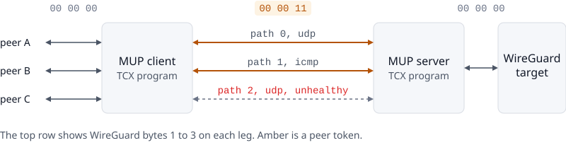
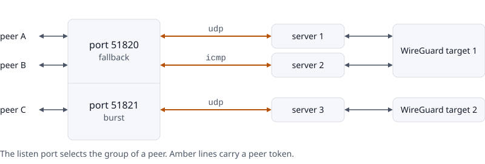
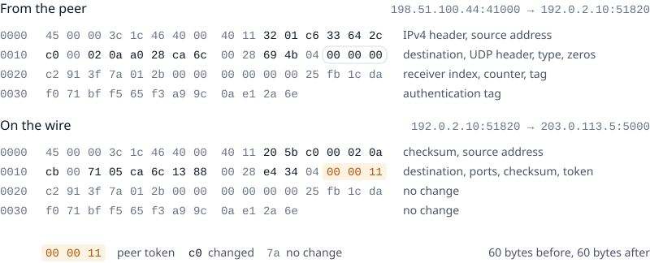
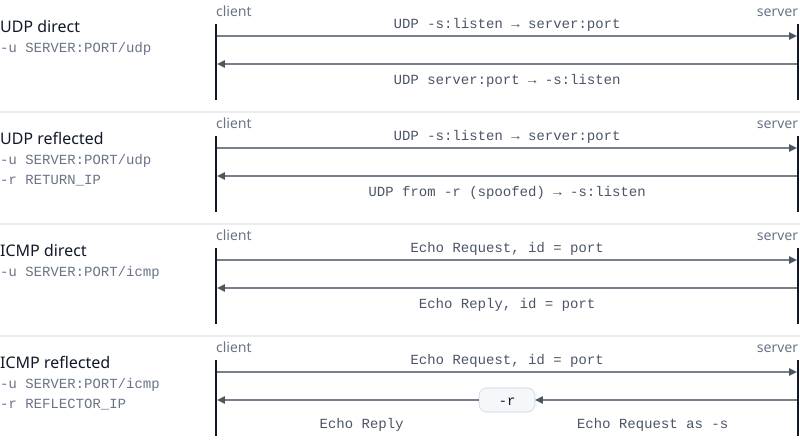
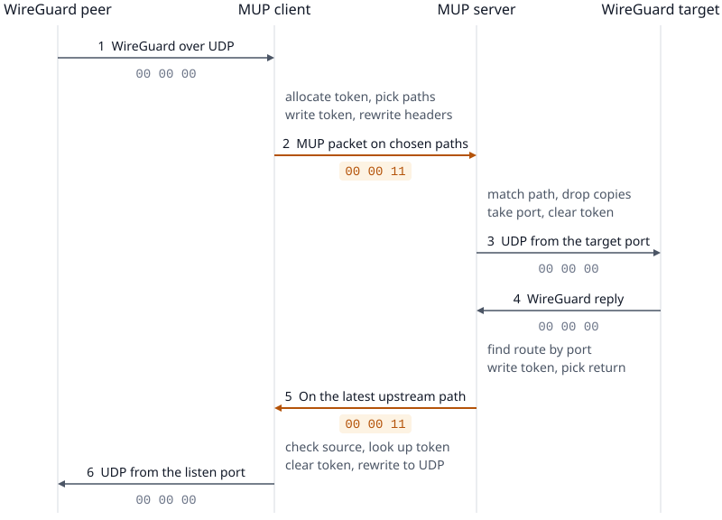
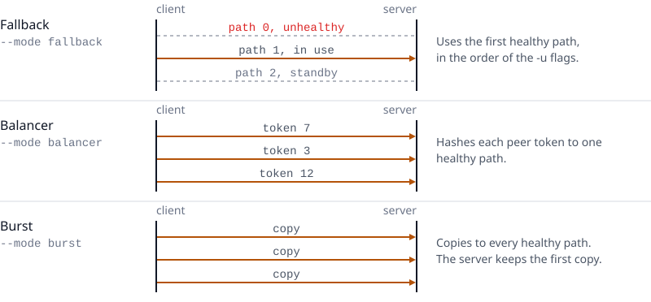
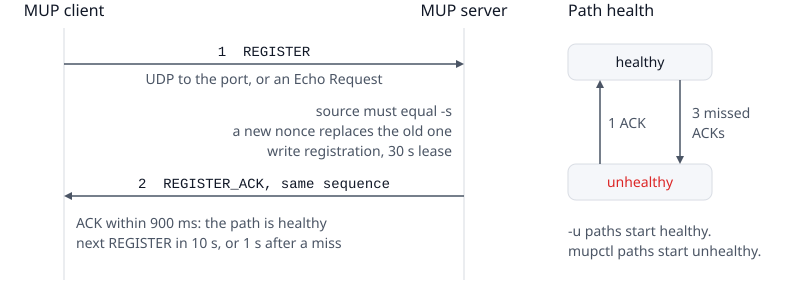
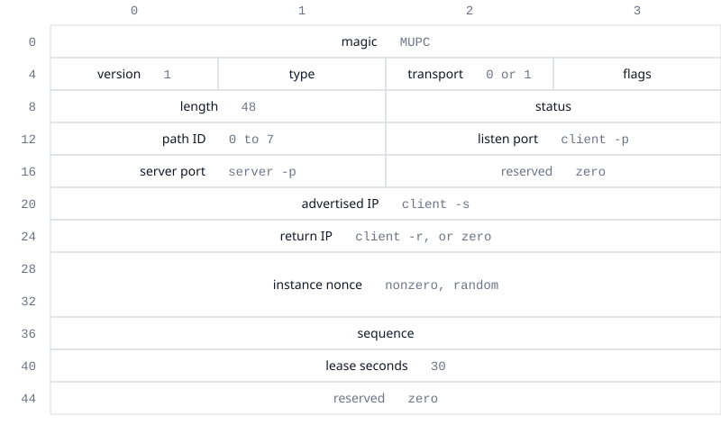
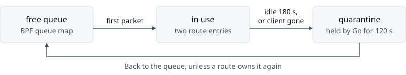

# MUP protocol

This document describes version 1 of the MUP protocol as the code implements it. It covers the packet formats, the control plane, the BPF maps, and the timers.

## Contents

1. [Terms](#terms)
2. [Topology](#topology)
3. [The peer token](#the-peer-token)
4. [Packet rewrites](#packet-rewrites)
5. [Transports and return modes](#transports-and-return-modes)
6. [Packet flow](#packet-flow)
7. [Path selection](#path-selection)
8. [Control plane](#control-plane)
9. [Path health](#path-health)
10. [Dataplane state](#dataplane-state)
11. [Lifetimes and cleanup](#lifetimes-and-cleanup)
12. [Input rules](#input-rules)
13. [Drop reasons](#drop-reasons)
14. [Attachment and restarts](#attachment-and-restarts)
15. [Observability](#observability)
16. [Control socket](#control-socket)
17. [Trust model](#trust-model)
18. [Limits](#limits)

## Terms

| Term | Meaning |
| --- | --- |
| WireGuard peer | A WireGuard endpoint that sends its packets to the MUP client. |
| WireGuard target | The one WireGuard endpoint behind the MUP server. The server `-r` flag sets it. |
| Path | One way from the client to a server. One client `-u` flag sets one path. |
| Group | One listen port with its mode and its paths. Each path has an optional return IP. |
| Port | The number in `-u SERVER:PORT` and in server `-p`. For UDP, it is the destination port. For ICMP, it is the Echo identifier. |
| Listen port | The client `-p` port of a group. The peers send to it, and downstream packets arrive on it. |
| Advertised IP | The client address in client `-s`. The server sends all replies to it. |
| Return IP | The optional client `-r` address of a group. For UDP, it is the spoofed source of replies. For ICMP, it is the reflector. |
| Peer token | A client-local number from 1 to 4095 that names one WireGuard peer. |
| Instance nonce | A random nonzero 64-bit number that a client picks at each start. |
| Client key | The advertised IP and the instance nonce together. The server uses it to tell clients apart. |
| Route | The state that joins one peer to its token, or one token to its target port. |
| Target port | A UDP source port from 20000 to 60999 that the server gives to one route. |
| Lease | The time that a registration stays valid without a new REGISTER frame. |
| Quarantine | A wait time before a free token or port goes back into use. |
| `TCX_NEXT` | The TCX verdict that passes a packet on to the kernel without a change. |

## Topology

<picture>
  <source media="(prefers-color-scheme: dark)" srcset=".docs/images/overview-dark.svg">
  
</picture>

One MUP server serves many MUP clients. Each client serves many WireGuard peers and uses up to eight paths in all. Each server forwards all traffic to one WireGuard target. Each active client of a server must use an advertised IP that no other client of that server uses.

MUP has two eBPF programs. `mup_client_ingress` runs on the client host, and `mup_server_ingress` runs on the server host. Each program attaches to the TCX ingress hook of every interface that is up at start. For a packet that MUP does not own, the program returns `TCX_NEXT`, and the kernel handles the packet as usual.

### Path groups

<picture>
  <source media="(prefers-color-scheme: dark)" srcset=".docs/images/groups-dark.svg">
  
</picture>

A client can serve several WireGuard targets, with one group for each. A group joins one listen port to a mode and a set of paths, and each path has an optional return IP. The port that a peer sends to selects its group. All servers of a group must forward to the same target, because a WireGuard handshake fails against another identity.

The groups share the advertised IP, the instance nonce, the eight path slots, and the pool of tokens. A token is unique in the client, so a downstream token gives the peer and its group. The client never moves a peer to another group.

The client configuration rejects one server address and port in two groups. The server keeps one listen port for each client key. Two groups on one server thus overwrite this value. The server keeps the return IP of each registered path.

## The peer token

<picture>
  <source media="(prefers-color-scheme: dark)" srcset=".docs/images/packet-dark.svg">
  
</picture>

A WireGuard message starts with a type byte and three reserved bytes. WireGuard sends the reserved bytes as zero. MUP uses them for the peer token while the packet travels between the MUP client and the MUP server. The token is a 24-bit big-endian number. Protocol v1 uses only the values 1 to 4095 and treats all other values as invalid.

The client keeps one token for each peer endpoint. A peer endpoint is the peer IP and port, the local IP, and the listen port. The server keys its routes by the client key and the token together, so two clients can use the same token. The token bytes are zero again before a WireGuard implementation reads the packet. WireGuard authentication and the handshake MACs thus stay valid.

## Packet rewrites

MUP rewrites every packet in place, as the hexdump in the previous section shows. A rewrite changes the IPv4 addresses, the IPv4 protocol field, all eight bytes of the UDP or ICMP header, and the peer token. UDP and ICMP headers are both eight bytes long. A packet can thus switch between UDP and ICMP without a change in length. The IPv4 total length, the TTL, the DF bit, and the WireGuard payload stay the same.

### Checksums

MUP computes the IPv4 header checksum again over the 20 header bytes. It updates the UDP or ICMP checksum incrementally, as RFC 1624 describes. The formula is `HC' = ~(~HC + ~m + m')`, where `m` holds the old words and `m'` holds the new words. First, it derives the sum of the payload from the old checksum and the old header words. Then it adds the new header words and writes the new checksum. The cost is the same for every packet size, and MUP never reads the payload bytes.

A valid checksum stays valid after a rewrite, and a corrupt checksum stays corrupt. The receiver then drops the corrupt packet as usual. The UDP checksum covers the UDP pseudo-header, and the ICMP checksum does not. A computed UDP checksum of zero goes on the wire as 0xffff, as RFC 768 requires.

If a UDP packet arrives without a checksum, MUP drops it and counts reason 20. A zero checksum field gives no payload sum to update. WireGuard implementations always send UDP checksums.

A target on the server host, for example `127.0.0.1`, answers from a local socket. Its replies have a partial checksum (`CHECKSUM_PARTIAL`): the UDP checksum field holds only the pseudo-header sum, and the network device adds the UDP header and the payload when it sends the packet. The server detects this case when the target IP equals the source IP of the target route. On a UDP path, the server writes the new pseudo-header sum and leaves the rest to the device. On an ICMP path, the device still writes the checksum at the UDP checksum offset, which is the Echo sequence field. A one's complement checksum is valid when all words add up to 0xffff, wherever the checksum word is. So the server clears the checksum and the sequence fields, and the device makes the ICMP checksum valid. The client does not read the sequence, because the peer token is in the WireGuard bytes.

`protocol/rewrite.go` is a copy of the algorithm in `bpf/include/rewrite.h`. Its tests make sure that each incremental result matches a full checksum of the packet.

## Transports and return modes

<picture>
  <source media="(prefers-color-scheme: dark)" srcset=".docs/images/return-modes-dark.svg">
  
</picture>

Each path uses UDP or ICMP. The return IP of a path sets the return mode of that path. The table shows the outer headers of each packet. In the table, "listen" is the listen port, "port" is the port of the path, and "token" is the peer token.

| Direction | Mode | Source | Destination | Transport header |
| --- | --- | --- | --- | --- |
| Upstream | UDP | `-s`:listen | server:port | UDP |
| Upstream | ICMP | `-s` | server | Echo Request, identifier = port, sequence = token |
| Downstream | UDP direct | server:port | `-s`:listen | UDP |
| Downstream | UDP reflected | return IP:port | `-s`:listen | UDP with a spoofed source |
| Downstream | ICMP direct | server | `-s` | Echo Reply, identifier = port, sequence = token |
| Downstream | ICMP reflected | `-s` | return IP | Echo Request, identifier = port, sequence = token |

In a downstream packet, "server" is the server address that received the latest upstream packet of the route.

In the UDP reflected mode, the return IP host never receives the packet. The server only writes the return IP as the source. The networks between the server and the client must accept a spoofed source. A network that filters source addresses (BCP 38) drops these packets.

In the ICMP reflected mode, the server sends an Echo Request from `-s` to the reflector. The reflector answers with an Echo Reply to `-s`, which is the client. Any host that answers ping can be the reflector. The network between the server and the reflector must accept the spoofed source.

The client accepts a downstream packet only from a source that a path of the group of the peer expects, with the port and the transport of that path. If the path has a return IP, the source must equal it. If the path has no return IP, the source must be the server address of the path. The client drops any other downstream packet and counts reason 22.

## Packet flow

<picture>
  <source media="(prefers-color-scheme: dark)" srcset=".docs/images/packet-flow-dark.svg">
  
</picture>

One round trip has four legs. The value under each arrow shows WireGuard bytes 1 to 3 on that leg, and amber marks a peer token. The sections below give the steps of each leg in order.

### Client upstream

A peer sends a UDP packet to the listen port of a group. The client program then does these steps:

1. It makes sure that the packet is a valid WireGuard message with zero reserved bytes.
2. It looks up the token of the peer endpoint. For a new peer, it takes a token from `free_peer_tokens`.
3. It picks one healthy path of the group. In burst mode, it picks every healthy path of the group.
4. It writes the token and rewrites the headers for the path.
5. It sends the packet out of the path interface with `bpf_redirect_neigh`, which resolves the next hop.

In burst mode, the program sends a clone on each healthy path of the group except the last one. For each clone, a FIB lookup gives the output interface and the MAC addresses. The original packet goes out on the last healthy path.

### Server upstream

A UDP packet arrives at a server port, or an ICMP Echo Request arrives with a server port as identifier. The server ports are one port or a range, for example 5000-6000. The server program then does these steps:

1. It makes sure that the packet is a valid WireGuard message with a token from 1 to 4095.
2. It looks up the registered path by source IP, local IP, port, and transport. The path gives the client key.
3. It makes sure that the registration of the client exists and did not expire.
4. If the duplicate cache holds the same route and first 24 WireGuard bytes, it drops the packet.
5. It finds the route of the client key and token. For a new route, it takes a port from `free_target_ports`.
6. It records the path of this packet as the return path of the route.
7. It clears the token and rewrites the packet to UDP, from the target port to the WireGuard target.
8. It sends the packet out of the interface that leads to the target.

The duplicate cache keeps each entry for 2 seconds. The first 24 WireGuard bytes hold the message type, the token, the receiver index, and the counter for data messages. Two different packets of one peer thus never share an entry.

### Target reply

A UDP packet from the target address and port arrives at a target port. The server program then does these steps:

1. It finds the route by the destination port.
2. It makes sure that the message is valid WireGuard with zero reserved bytes.
3. It makes sure that the registration of the client is still live.
4. It writes the token and rewrites the headers for the return path of the route.
5. It sends the packet out of the interface where the latest upstream packet of the route arrived.

### Client downstream

A packet with a nonzero token arrives at the advertised IP. The client program then does these steps:

1. It makes sure that a UDP packet goes to the listen port of a group.
2. It makes sure that an ICMP packet is an Echo Reply with the port of an ICMP path.
3. It makes sure that the message is valid WireGuard with a token from 1 to 4095.
4. It finds the peer endpoint by the token. The listen port of the endpoint gives the group.
5. It makes sure that the source is an expected source for that group, as the return modes section describes.
6. It clears the token and rewrites the packet to UDP, from the listen address to the peer.
7. It sends the packet out of the interface where the traffic of the peer arrives.

## Path selection

<picture>
  <source media="(prefers-color-scheme: dark)" srcset=".docs/images/modes-dark.svg">
  
</picture>

The client program reads the healthy path mask from `path_state` for each packet. It keeps only the bits in the path mask of the group of the peer. The mode of the group then selects one of three rules:

- Fallback: The program uses the healthy path with the lowest priority. The priority is the position of the path in the configuration.
- Balancer: The program computes a hash of the token and the mask, and uses it to pick one healthy path.
- Burst: The program sends the packet on every healthy path.

The balancer hash is `h = token * 0x9e3779b1 ^ mask * 0x85ebca6b`, then `h ^= h >> 16`. The index of the path in the list of healthy paths is `h % count`. A peer thus stays on one path until the set of healthy paths in its group changes. A health change in another group does not move the peer.

The server does not select paths. It replies on the path of the latest upstream packet of each route. After a failover, the first upstream packet on the new path moves the downstream traffic too. In burst mode, the first copy to arrive sets the return path.

## Control plane

<picture>
  <source media="(prefers-color-scheme: dark)" srcset=".docs/images/control-plane-dark.svg">
  
</picture>

### Registration

The client registers each path on its own. It sends a REGISTER frame from `-s` to the server address of the path. A UDP path sends the frame in a UDP datagram to the server port. An ICMP path sends the frame as the payload of an Echo Request, with the port as identifier. The frame holds the listen port of the group and the return IP of the path. The TCX programs pass these frames to the kernel, and the Go control plane answers them.

For each REGISTER, the server makes sure that all of these conditions are true:

- The source address of the packet equals the advertised IP in the frame.
- The port in the frame is a server port, and the frame arrived on that port.
- The transport in the frame equals the transport that carried the frame.
- The path ID is from 0 to 7.

The server then writes the registration to `registration_by_key` and the path to `registered_paths`. Both entries get a lease of 30 seconds. The server answers with a REGISTER_ACK frame from the address that received the REGISTER. The ACK repeats the frame with the type REGISTER_ACK, the status 0, and a lease of 30 seconds. If a condition is false, the server sends no reply.

The client waits 900 milliseconds for an ACK with the same nonce, path ID, and sequence. After an ACK, it sends the next REGISTER in 10 seconds. After a missing ACK, it sends the next REGISTER in 1 second. After 3 missing ACKs in a row, a UDP path closes its control socket and opens a new one. The new socket gets a new source port, because a filter on the network can block one UDP flow and let a new flow pass. An ICMP path cannot do this, because its Echo identifier must equal the server port.

### Client restarts

A client picks a new instance nonce at each start. The server keeps one registration for each advertised IP. A REGISTER with a new nonce replaces the registration of the old nonce. The next sweep then deletes the paths and routes of the old nonce.

### Control frame

<picture>
  <source media="(prefers-color-scheme: dark)" srcset=".docs/images/control-frame-dark.svg">
  
</picture>

The control frame is 48 bytes long, and all integers are big-endian.

| Offset | Size | Field | Value |
| ---: | ---: | --- | --- |
| 0 | 4 | magic | 0x4d555043, which is "MUPC" in ASCII. |
| 4 | 1 | version | 1. |
| 5 | 1 | type | 1 is REGISTER and 2 is REGISTER_ACK. Types 3 to 6 are reserved. |
| 6 | 1 | transport | 0 is UDP and 1 is ICMP. |
| 7 | 1 | flags | Bit 0 means that the return IP field is set. The other bits must be zero. |
| 8 | 2 | length | 48. |
| 10 | 2 | status | 0 is OK. Values 1 to 6 name errors, but the v1 server does not send them. |
| 12 | 2 | path ID | 0 to 7, the slot of the path in the client. |
| 14 | 2 | listen port | The listen port of the group of the path. |
| 16 | 2 | server port | The server port. |
| 18 | 2 | reserved | Zero. |
| 20 | 4 | advertised IP | The client `-s` address. |
| 24 | 4 | return IP | The return IP of the path, or zero. |
| 28 | 8 | instance nonce | The nonzero random number of the client process. |
| 36 | 4 | sequence | A counter that goes up by one with each REGISTER on the path. |
| 40 | 4 | lease seconds | 30. |
| 44 | 4 | reserved | Zero. |

Some payloads are exactly 48 bytes long and start with the magic, version 1, and length 48. The TCX programs pass such a payload to the kernel as a control frame.

## Path health

The client measures the health of each path with the ACKs to its REGISTER frames. A path from the flags or the configuration file starts healthy. A path that `mupctl` adds starts unhealthy. Three missed ACKs in a row make a path unhealthy, and one ACK makes it healthy again. Each change increases the generation. Go writes the mask of healthy paths and the generation to `path_state`.

A dead path becomes unhealthy about 5 to 15 seconds after it fails. The delay depends on the time that remains until the next REGISTER. If no path of a group is healthy, the client drops the upstream packets of that group and counts reason 15.

## Dataplane state

Pinned BPF maps hold all dataplane state. Go writes the configuration and the registrations. The programs create routes, and Go expires them.

| Map | Type | Capacity | Key and value | Writer |
| --- | --- | ---: | --- | --- |
| `client_config` | array | 1 | Nonce, `-s`, and generation. | Go |
| `path_groups` | hash | 8 | Listen port to mode and path mask. The return IP and flags fields are not used. | Go |
| `path_config` | array | 8 | Destination, source, interface, port, transport, and priority of each path. | Go |
| `path_returns` | array | 8 | Return IP and flags of each path. | Go |
| `path_state` | array | 1 | Healthy mask and generation. | Go |
| `client_peer_by_endpoint` | hash | 4096 | Peer endpoint to token and last-seen time. | Program |
| `client_endpoint_by_token` | hash | 4096 | Token to peer endpoint, interface, and last-seen time. | Program |
| `free_peer_tokens` | queue | 4095 | Unused tokens. | Both |
| `server_config` | array | 1 | Target, source IP, interface, and the first server port. | Go |
| `server_ports` | array | 1 | The first and the last server port. Without this entry, the server accepts only the port in `server_config`. | Go |
| `registration_by_key` | hash | 4096 | Client key to lease end and listen port, with the return IP and flags of the latest REGISTER. The programs do not read the return IP. | Go |
| `registered_paths` | hash | 32768 | Source IP, local IP, port, and transport to client key, return IP, and flags. | Go |
| `server_route_by_key` | hash | 41000 | Client key and token to target port and return path. | Program |
| `server_route_by_port` | hash | 41000 | Target port to route key and return path. | Program |
| `free_target_ports` | queue | 41000 | Unused target ports. | Both |
| `duplicate_cache` | LRU hash | 16384 | Route key and first 24 WireGuard bytes to the time seen. | Program |
| `stats` | per-CPU array | 23 | Drop counters, one for each reason. | Program |
| `events` | ring buffer | 256 KiB | Events for reasons 11, 12, and 13. | Program |
| `event_limits` | array | 23 | Rate limit of the events for each reason. | Program |

Each route has a forward entry and a reverse entry that point at each other. The program writes the forward entry first. If the reverse entry fails, the program deletes the forward entry and returns the token or port to its queue. The last-seen times in the maps use the monotonic clock of the kernel.

## Lifetimes and cleanup

<picture>
  <source media="(prefers-color-scheme: dark)" srcset=".docs/images/lifetimes-dark.svg">
  
</picture>

Go runs a sweep once per second. The sweep does these steps in order:

1. It repairs broken pairs of forward and reverse entries, and quarantines their tokens and ports.
2. It deletes expired registrations, and the paths of expired or replaced registrations.
3. It deletes client routes that had no traffic for 180 seconds.
4. It deletes server routes that had no traffic for 180 seconds, and the routes of deleted registrations.
5. It returns the tokens and ports with an ended quarantine to their queues.

In step 5, a value that a route owns again stays out of the queue. The expiry of that route puts the value into quarantine again. The quarantine of 120 seconds keeps a late packet of an old route away from a new peer.

The sweep copies each map before it deletes entries, because a deletion restarts a map iteration. Before it deletes a route, it reads the route again. If the program refreshed the route in the meantime, the sweep keeps it.

| Timer | Value | Purpose |
| --- | ---: | --- |
| Registration refresh | 10 s | Time between REGISTER frames on a healthy path. |
| Registration retry | 1 s | Time before the next REGISTER after a missed ACK. |
| UDP socket reopen | 3 misses | Missed ACKs in a row before a UDP path opens a new control socket. |
| ACK timeout | 900 ms | Time that the client waits for a REGISTER_ACK. |
| Missed ACKs | 3 | Missed ACKs in a row that make a path unhealthy. |
| Registration lease | 30 s | Life of a registration without a new REGISTER. |
| Route idle timeout | 180 s | Life of a route without traffic. |
| Quarantine | 120 s | Wait before a token or port goes back into use. |
| Duplicate window | 2 s | Time in which the server drops a burst copy. |
| Sweep | 1 s | Time between two sweeps. |

## Input rules

The programs forward only IPv4 packets with a 20-byte header, no fragments, and a UDP or ICMP header. The UDP length must match the IPv4 total length. The WireGuard message must have a valid length for its type.

| Type | Message | Length in bytes |
| ---: | --- | --- |
| 1 | Handshake initiation | 148 |
| 2 | Handshake response | 92 |
| 3 | Cookie reply | 64 |
| 4 | Transport data | 32 or more. Senders should pad to a multiple of 16, but some clients, for example Surge, do not. |

A program returns `TCX_NEXT` for traffic that it does not own. This traffic includes non-IPv4 packets, malformed IPv4 packets, other protocols, and packets to other ports. A program drops and counts a packet that is addressed to MUP but breaks a rule. An ICMP packet with an identifier other than the MUP port is not addressed to MUP.

## Drop reasons

| Reason | Name | Meaning |
| ---: | --- | --- |
| 1 | `MALFORMED_IPV4` | The IPv4 header is short, or its length is wrong. Only the burst code counts it, after a clone. |
| 2 | `IPV4_OPTIONS` | The IPv4 header has options. Only the burst code counts it, after a clone. |
| 3 | `IPV4_FRAGMENT` | The packet is a fragment. Only the burst code counts it, after a clone. |
| 4 | `MALFORMED_L4` | The UDP or ICMP header is short, or the UDP length is wrong. Only the burst code counts it, after a clone. |
| 5 | `WG_TYPE` | The WireGuard type is not 1 to 4. |
| 6 | `WG_LENGTH` | The WireGuard length does not match the type. |
| 7 | `WG_RESERVED` | The reserved bytes are not zero from WireGuard, or not a token from 1 to 4095 between MUP endpoints. |
| 8 | `NOT_REGISTERED` | The server has no live registration for the path or the client. |
| 9 | `PATH_MISMATCH` | Reserved. Version 1 does not count it. |
| 10 | `TRANSPORT` | A path or a route has an unknown transport. |
| 11 | `PEER_TOKEN_POOL` | The client has no free token. |
| 12 | `TARGET_PORT_POOL` | The server has no free target port. |
| 13 | `MAP_INVARIANT` | A forward entry and its reverse entry disagree, or a map update failed. |
| 14 | `ROUTE_MISS` | The server has no route for the target port, or the client has no peer for the token. |
| 15 | `NO_PATH` | The group of the peer has no healthy path. |
| 16 | `DUPLICATE` | The server already forwarded this burst copy. |
| 17 | `FIB` | A burst clone got no FIB result for its path. MUP skips the clone, not the packet. |
| 18 | `NEIGHBOR` | A burst clone failed to redirect. MUP skips the clone, not the packet. |
| 19 | `TAIL_CALL` | Reserved. Version 1 does not count it. |
| 20 | `CHECKSUM` | A rewrite failed, for example on a UDP packet without a checksum. |
| 21 | `RETURN_POLICY` | Reserved. Version 1 does not count it. |
| 22 | `DOWNSTREAM_SOURCE` | A downstream packet came from a source that the group of the peer does not expect. |

## Attachment and restarts

The loader pins the maps by name under `/sys/fs/bpf/mup/client` or `/sys/fs/bpf/mup/server`. It pins each TCX link under `/sys/fs/bpf/mup/<role>/<role>/<ifindex>/ingress`. The client attaches to every interface that is up and to the interface of each path. The server attaches to every interface that is up and to the interface that leads to the target.

At start, the loader does these steps in order:

1. It loads the programs with the pinned maps, or it creates and pins new maps.
2. It repairs broken pairs of forward and reverse entries.
3. For a new queue, it fills the queue with every token or port.
4. For an existing queue, it puts each lost token or port into quarantine.
5. It deletes the groups that are not in the configuration, and it writes the configuration of the role.
6. It replaces the program in each pinned link, or it attaches and pins a new link.

A lost token or port is not free, not in a route, and not in quarantine. A crash between a pop and a route insert can lose one. Step 6 keeps forwarding active during a restart.

The TCX links stay attached after the process stops. The programs then forward with the last state, and routes no longer expire. The server programs still stop a client at the end of its lease, because they compare the lease end with the clock. To remove MUP from a host, stop the process and delete the pin directory of the role.

## Observability

The daemon does not log counters. The control socket reports them on demand, and `mupctl status` shows them. The table lists the source of each value.

| Value | Role | Source |
| --- | --- | --- |
| Drops | Both | The `stats` map, summed over all CPUs. |
| Paths | Client | The healthy mask and the generation in `path_state`. |
| Peers | Client | The entries in `client_peer_by_endpoint`. The local port of an entry gives its group. |
| Peer tokens | Client | 4095, minus the routes, minus the tokens in quarantine. |
| Clients | Server | The entries in `registration_by_key` and `registered_paths`. |
| Peers | Server | The entries in `server_route_by_key`. |
| Target ports | Server | 41000, minus the routes, minus the ports in quarantine. |
| Duplicates | Server | The entries in `duplicate_cache`. |

The programs write events to the `events` ring buffer for reasons 11, 12, and 13. Each reason writes at most 10 events per minute. Go logs each event with the reason, the interface index, and the monotonic time. The logs never contain payloads or peer addresses.

## Control socket

The daemon serves a control API for `mupctl` on a Unix socket. The default socket is `/run/mup/client.sock` for a client and `/run/mup/server.sock` for a server. The daemon creates the socket at each start with mode 0660. It replaces a stale socket file. If another daemon still answers on the socket, the start fails.

The API is JSON over HTTP/1.1. The file `api/api.go` defines the request and response types.

| Method | Path | Role | Result |
| --- | --- | --- | --- |
| `GET` | `/v1/status` | Both | The overview and the drop counters. |
| `GET` | `/v1/paths` | Client | The paths with their health. |
| `POST` | `/v1/paths` | Client | Adds a path. The body is `{"path": "SERVER[%IFACE]:PORT/udp", "listen_port": 51820}`. |
| `DELETE` | `/v1/paths/{id}` | Client | Removes a path. |
| `PUT` | `/v1/mode` | Client | Changes the mode of a group. The body is `{"mode": "burst", "listen_port": 51820}`. |
| `GET` | `/v1/peers` | Both | The peers of a client, or the peer routes of a server. |
| `GET` | `/v1/clients` | Server | The registered clients with their paths. |

The `listen_port` field selects a group. A client with one group does not need it. The status response of a client lists its groups.

A failed request returns a JSON object with an `error` field. The status is 400 for an invalid request and 404 for an unknown path ID or group. It is 409 for a request that the role or the current state does not allow, and 500 for a failure in the dataplane.

### Runtime path changes

A client has eight path slots. The slot number is the path ID in REGISTER frames, the bit in the healthy mask, and the index in `path_config`. A new path takes the lowest free slot and the next free priority. In fallback mode, a new path thus comes after the existing paths of its group. The groups do not change while the daemon runs.

The client adds a path in this order:

1. It opens the control socket of the path.
2. It attaches the client program to a new interface of the path.
3. It writes the path to `path_config`.
4. It adds the slot to the path mask of the group in `path_groups`.
5. It starts the REGISTER loop. The path becomes healthy at its first ACK.

The client removes a path in this order:

1. It stops the REGISTER loop.
2. It clears the bit of the path in `path_state`.
3. It clears the slot in the path mask of the group.
4. It clears the entry of the path in `path_config`.

The client program thus never picks a path with a partial configuration. A result from an old REGISTER loop has no effect on a new path in the same slot. The client does not remove the last path of a group. The server needs no change, because it learns each path from its REGISTER frames. The lease of a removed path ends after 30 seconds.

Path changes are not saved. At the next start, the daemon uses its flags or its configuration file again.

## Trust model

MUP has no keys and no authentication of its own. It relies on these facts:

- WireGuard authenticates its handshake and its encrypted payload end to end.
- The server accepts data only on a live registered path, and the path gives the client key.
- The client accepts downstream packets only from the paths of the group of the peer: from the server of a path, or from the return IP of a path.
- The target accepts only valid WireGuard messages.

A host can spoof the source address of a registered client. That host can then register paths for the client, change its return mode, and drop or misroute its traffic. It cannot read or forge WireGuard payloads. Use MUP only on networks where you control the hosts and the routing.

The duplicate cache is a filter for burst copies, not a replay defense. WireGuard provides replay protection for its transport data.

## Limits

- MUP supports IPv4 only. It forwards no IPv4 options and no fragments.
- The largest WireGuard message is the path MTU minus 28 bytes, which is 1472 bytes at MTU 1500. WireGuard needs no MTU change.
- A client has up to 8 paths in all groups.
- A client serves up to 4095 peers in all groups. A server holds up to 41000 routes and 4096 registrations.
- Each active client of a server needs its own advertised IP.
- A server port range has up to 4096 ports. The server opens one UDP control socket for each port.
- MUP attaches only to the interfaces that are up at start.
- The server treats every UDP packet from the target address and port to its source IP as a reply. Do not run other clients of the same target on the server host with that source IP.
- MUP needs a complete transport checksum on each input packet. The one exception is a reply of a target on the server host, which the server handles as a partial checksum. Other local traffic through a veth pair with checksum offload can carry an unfinished checksum, and MUP does not support it.
