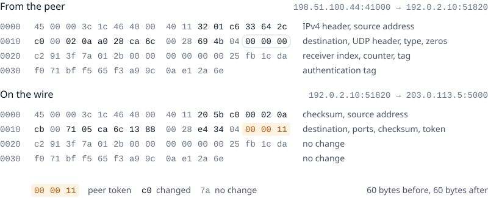
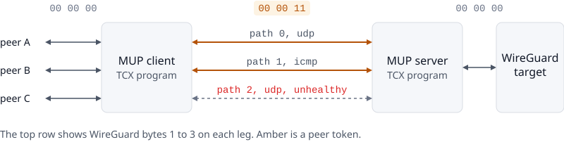
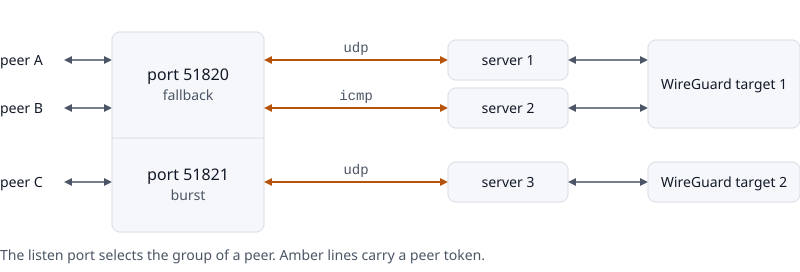
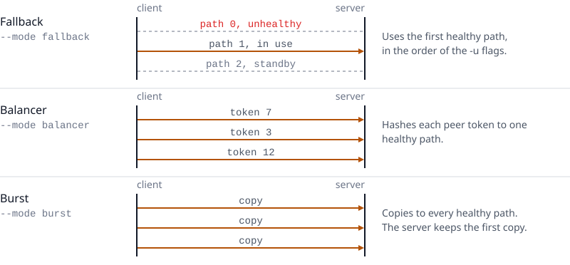
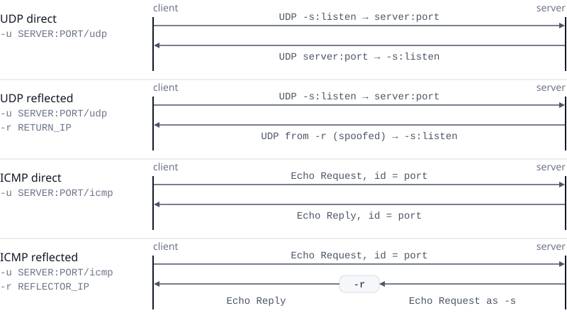

# MUP

MUP carries WireGuard traffic over several UDP or ICMP paths between two Linux hosts. It is for people who run their own WireGuard gateways.

<picture>
  <source media="(prefers-color-scheme: dark)" srcset=".docs/images/packet-dark.svg">
  
</picture>

This is one WireGuard keepalive on a UDP path. The MUP client rewrites it, and the packet keeps its 60 bytes and gets no tunnel header. The amber bytes hold the peer token, a number from 1 to 4095 that identifies the peer. WireGuard still encrypts and authenticates the payload from end to end.

A MUP client and a MUP server attach eBPF programs to the TCX ingress hook of Linux. The programs forward all data packets, and no data packet enters Go. Go runs the control plane: registration, path health, cleanup, and logs. The `mupctl` command shows the state of a running daemon and changes its paths.

## How it works

<picture>
  <source media="(prefers-color-scheme: dark)" srcset=".docs/images/overview-dark.svg">
  
</picture>

Peers send to the MUP client, not to the real WireGuard server. The client gives each peer a peer token and writes it into three bytes that WireGuard always sends as zero. Then it sends the packet to the MUP server on one or more paths. The server clears the token and forwards the packet to the WireGuard target. Replies go back the same way.

If a path stops answering, the client moves traffic away from it. One server can serve many clients, and it forwards all of their traffic to one WireGuard target.

<picture>
  <source media="(prefers-color-scheme: dark)" srcset=".docs/images/groups-dark.svg">
  
</picture>

One client can also serve several WireGuard targets. A path group joins one listen port to the servers of one target. A peer selects its target with the port in its `Endpoint`.

<picture>
  <source media="(prefers-color-scheme: dark)" srcset=".docs/images/modes-dark.svg">
  
</picture>

Each group has one of three path modes. Fallback uses the first healthy path. Balancer spreads the peers over the healthy paths. Burst sends a copy on every healthy path, and the server keeps the first copy that arrives.

<picture>
  <source media="(prefers-color-scheme: dark)" srcset=".docs/images/return-modes-dark.svg">
  
</picture>

The return IP of a group sets its return mode. The client `-r` flag or the `return_ip` key sets it. Without a return IP, the server replies directly with the transport of the path. On a UDP path, the server sends replies from the return IP. On an ICMP path, the server sends an Echo Request to the return IP, and that host answers the client.

[PROTOCOL.md](PROTOCOL.md) describes every packet, map, timer, and drop reason.

## Requirements

- Linux 6.6 or later, with TCX and a bpffs mount at `/sys/fs/bpf`
- Root, or the capabilities to load BPF programs, attach TCX links, open raw ICMP sockets, and bind sockets to interfaces
- IPv4 between the peers, the client, the server, and the target
- Go 1.27.3 or later to build, and clang/LLVM to change the BPF code

MUP does not attach XDP programs, and it has no fallback to legacy TC.

## Install

The release images are at `ghcr.io/xshecan/mup`. Each image has `mup` and `mupctl`, and its entry point is `mup`.

```sh
docker pull ghcr.io/xshecan/mup:latest
```

To use the Go packages in another module, add this module:

```sh
go get github.com/xshecan/mup@latest
```

## Quick start

The example uses one client host, one server host with two addresses, and a WireGuard server at 198.51.100.7.

1. Build the daemon and `mupctl`:

   ```sh
   go build ./cmd/mup
   go build ./cmd/mupctl
   ```

2. On the server host, start the server:

   ```sh
   sudo ./mup server -p 5000 -r 198.51.100.7:51820
   ```

3. On the client host, start the client with one UDP path and one ICMP path. The address 192.0.2.10 must be an address of the client host.

   ```sh
   sudo ./mup client -p 51820 \
     -u 203.0.113.5:5000/udp \
     -u 203.0.113.6:5000/icmp \
     -s 192.0.2.10
   ```

4. In the configuration of each WireGuard peer, set `Endpoint` to the client host and port 51820.

5. On the client host, make sure that the paths are healthy:

   ```sh
   sudo ./mupctl status
   ```

The WireGuard server then sees the MUP server as the endpoint of each peer. WireGuard accepts the new endpoint, because it authenticates each packet and not the address.

## Configuration file

The flags of the daemon configure one server, or one client with one group. A YAML file can do the same, and it can configure more groups. The file selects the role. The directory `configs` has one example for each role.

```sh
sudo ./mup --config configs/client.yaml
```

```yaml
client:
  advertise: 192.0.2.10
  groups:
    - port: 51820
      mode: fallback
      paths:
        - 203.0.113.5:5000/udp
        - 203.0.113.6:5000/icmp
    - port: 51821
      mode: burst
      paths:
        - 198.51.100.20:6000/udp
```

```yaml
server:
  port: 5000
  target: 198.51.100.7:51820
```

| Key | Flag | Meaning |
| --- | --- | --- |
| `client.advertise` | `-s` | The advertised IP. |
| `client.control_socket` | `--control-socket` | Optional. The socket for `mupctl`. An empty value turns the socket off. |
| `client.groups[].port` | `-p` | The port where the group receives packets from its peers. |
| `client.groups[].mode` | `--mode` | Optional. The path mode of the group. The default is `fallback`. |
| `client.groups[].return_ip` | `-r` | Optional. The return IP of the group. |
| `client.groups[].paths` | `-u` | The paths of the group, in the form of the `-u` flag. |
| `server.port` | `-p` | The UDP port and the ICMP Echo identifier that the server accepts. |
| `server.target` | `-r` | The WireGuard target that receives all traffic. |
| `server.control_socket` | `--control-socket` | Optional. The socket for `mupctl`. An empty value turns the socket off. |

The daemon does not start with an unknown key in the file. A value can use `${VARIABLE}`, or `${VARIABLE:default}` with a default value.

## Several WireGuard targets

To reach several WireGuard targets from one client, do these steps:

1. For each target, start one or more MUP servers that forward to that target.
2. In the client configuration file, add one group for each target. Add the paths to the servers of that target.
3. In the configuration of each WireGuard peer, set the port in `Endpoint` to the listen port of its group.

These rules apply to groups:

- All servers of a group must forward to the same target, because a WireGuard handshake fails against another identity.
- A server address and port can be in one group only. The server keeps one return IP and one listen port for each client.
- The client cannot detect one host with two addresses in two groups. Do not configure this.
- All groups share the 8 paths and the 4095 peers of a client.
- If no path of a group is healthy, its peers have no path. MUP does not move them to another group, because that group leads to another target.

## Docker Compose

The file `compose.yaml` runs one role on each host, and a profile selects the role. Each role reads its [configuration file](#configuration-file) from the directory `configs`. The container uses the host network, because TCX attaches to the interfaces of the host. It runs in privileged mode, because the daemon loads BPF programs and writes pins under `/sys/fs/bpf`. The image has both `mup` and `mupctl`.

1. In `configs/server.yaml` and `configs/client.yaml`, replace the example addresses with your addresses.

2. On the server host, start the server:

   ```sh
   docker compose --profile server up -d --build
   ```

3. On the client host, start the client:

   ```sh
   docker compose --profile client up -d --build
   ```

4. On the client host, make sure that the paths are healthy:

   ```sh
   docker compose exec client mupctl status
   ```

Do not use `docker compose down` to remove MUP from a host. The TCX links stay attached after the container stops, and they keep forwarding with the last state. To remove MUP, stop the container and do the steps in [Restart and removal](#restart-and-removal).

## Command reference

The command `mup --config FILE` reads a [configuration file](#configuration-file). The flags below configure the daemon without a file.

### Client

```text
mup client -p LISTEN_PORT -u SERVER_IP[%IFACE]:PORT/udp|icmp [-u ...] -s CLIENT_IP [-r RETURN_IP]
           [--mode fallback|balancer|burst] [--control-socket PATH]
```

| Flag | Value | Meaning |
| --- | --- | --- |
| `-p` | port | The UDP port where the client receives WireGuard packets from the peers. |
| `-u` | `SERVER_IP[%IFACE]:PORT/udp` or `/icmp` | One path to a server. Repeat the flag for up to 8 paths. The optional `%IFACE` binds the path to one interface. |
| `-s` | IPv4 | The advertised IP. It must be an address of the client host, and no other active client of the server can use it. |
| `-r` | IPv4 | Optional. On UDP paths, the spoofed source of replies. On ICMP paths, the reflector host. |
| `--mode` | `fallback`, `balancer`, `burst` | The path mode. The default is `fallback`. |
| `--control-socket` | path | The socket for `mupctl`. The default is `/run/mup/client.sock`. An empty value turns the socket off. |

### Server

```text
mup server -p PORT -r TARGET_IP:TARGET_PORT [--control-socket PATH]
```

| Flag | Value | Meaning |
| --- | --- | --- |
| `-p` | port | The UDP port and the ICMP Echo identifier that the server accepts. |
| `-r` | IPv4:port | The WireGuard target that receives all traffic. |
| `--control-socket` | path | The socket for `mupctl`. The default is `/run/mup/server.sock`. An empty value turns the socket off. |

There are no authentication keys. WireGuard authenticates the payload end to end.

## mupctl

`mupctl` talks to a running daemon over its control socket. It works in the style of kubectl. It shows the health of the paths, the connected peers, and the drop counters. On a client, it also adds and removes paths and changes the path mode of a group.

| Command | Role | What it does |
| --- | --- | --- |
| `mupctl status` | both | Shows an overview. A client lists its groups and paths, and a server lists its clients. |
| `mupctl get groups` | client | Lists the groups with their mode, return IP, healthy paths, and peers. |
| `mupctl get paths` | client | Lists the paths with their health, last ACK, and round-trip time. |
| `mupctl get peers` | both | Lists the WireGuard peers of a client, or the peer routes of a server. |
| `mupctl get clients` | server | Lists the registered clients with their paths, peers, and lease. |
| `mupctl get drops` | both | Lists the nonzero drop counters. |
| `mupctl add path SERVER[%IFACE]:PORT/udp` | client | Adds a path to a group. The value uses the form of the `-u` flag. |
| `mupctl delete path ID` | client | Removes a path. |
| `mupctl set mode burst` | client | Changes the path mode of a group to `fallback`, `balancer`, or `burst`. |

On a client, `mupctl status` prints this overview:

```text
$ sudo mupctl status
Role:            client
Advertised IP:   192.0.2.10
Uptime:          3h12m
Paths:           2/3 healthy, generation 7
Peers:           3
Peer tokens:     4092 free, 0 quarantined
Drops:           37 (NO_PATH 30, WG_LENGTH 7)

GROUP   MODE       RETURN IP   PATHS         PEERS
51820   fallback   none        2/2 healthy   2
51821   burst      none        0/1 healthy   1

ID   GROUP   SERVER               TRANSPORT   INTERFACE   STATUS      IN USE   LAST ACK   RTT
0    51820   203.0.113.5:5000     udp         eth0        healthy     yes      4s         12.3ms
1    51820   203.0.113.6:5000     icmp        eth1        healthy     no       7s         18.7ms
2    51821   198.51.100.20:6000   udp         wwan0       unhealthy   no       2m10s      64.1ms
```

The IN USE column shows the paths that carry traffic in the mode of their group. In fallback mode, only the first healthy path of the group carries traffic.

```text
$ sudo mupctl get peers
TOKEN   PEER                  LOCAL              INTERFACE   IDLE
1       198.51.100.44:41000   192.0.2.10:51820   eth0        2s
2       198.51.100.45:39112   192.0.2.10:51820   eth0        14s
3       203.0.113.90:51820    192.0.2.10:51821   eth0        1m35s
```

A peer counts as connected until it is idle for 180 seconds. Then its route expires.

These flags work with every command:

- `-o wide` adds columns, for example the priority and missed ACKs of each path.
- `-o json` prints the raw API response.
- `-w` shows the output again every second. It works with `status` and `get`.
- `--socket PATH` selects the daemon. Without it, `mupctl` uses `$MUP_SOCKET`, then the one default socket that exists.
- `--group LISTEN_PORT` selects the group for `add path` and `set mode`. A client with one group does not need it.

These rules apply to path changes:

- A new path stays unhealthy until the server answers its first REGISTER. This usually takes less than one second.
- A client has at most 8 paths in all groups.
- `mupctl` does not remove the last path of a group. Add the new path first.
- `mupctl` does not add or remove groups. To change the groups, edit the configuration file and restart the daemon.
- The changes last until the daemon restarts. The daemon then uses its flags or its configuration file again.

Run `mupctl` as root. The daemon creates the socket at each start, with mode 0660 and root as the owner.

## Logs

The daemon does not log counters. Use `mupctl status` or `mupctl get drops` to read them. The daemon logs an event for an empty pool of tokens or ports. It also logs an event for a forward route entry that disagrees with its reverse entry. Each of these reasons logs at most 10 events per minute. The logs never contain payloads or peer addresses.

The [drop reason table](PROTOCOL.md#drop-reasons) explains each counter.

## Restart and removal

If you restart MUP, keep the pin directory. The new process reuses the pinned maps and replaces the programs in the pinned TCX links, so forwarding does not stop.

The TCX links stay attached after the process stops, and they keep forwarding with the last state. To remove MUP from a host, do these steps:

1. Stop the process.
2. Delete the pin directory of the role, `/sys/fs/bpf/mup/client` or `/sys/fs/bpf/mup/server`:

   ```sh
   sudo rm -r /sys/fs/bpf/mup/client
   ```

If a new version of MUP changes a map layout, the load fails with the old pins. Delete the pin directory before you start the new version.

## Build

The Go package embeds the generated BPF objects:

```sh
go generate ./dataplane
go test ./...
go build ./cmd/mup
go build ./cmd/mupctl
```

Generation requires clang/LLVM. A build from a checkout that already has the generated objects does not.

The diagrams come from one Python script that uses only the standard library. To change a diagram, edit the script and render the SVG files again:

```sh
python3 .docs/render_diagrams.py
```

## Linux qualification

Run the privileged verifier and namespace tests on the deployment kernel before production use:

```sh
sudo -E go test ./dataplane -count=1 -v
sudo -E env MUP_PRIVILEGED_TESTS=1 go test ./integration -count=1 -v
```

The integration test creates disposable network namespaces and private bpffs mounts. It then sends UDP and ICMP round trips in the direct and reflected modes. It also sends packets through two groups to two WireGuard targets. To measure real PPS, bandwidth, drops, and CPU, use the namespace topology with the production NICs.

macOS can compile the Linux code, but it cannot load the programs or run the privileged tests.

## Security

MUP has no authentication of its own. A host can spoof the source address of a registered client. That host can then register paths for the client, change its return mode, and drop or misroute its traffic. That host cannot read or forge WireGuard payloads, because WireGuard authenticates them end to end. Use MUP only on networks where you control the hosts and the routing.

## Limits

- IPv4 only, with no IPv4 options and no fragments.
- Up to 8 paths and up to 4095 peers per client, shared by all of its groups.
- Up to 41000 routes per server, and up to 4096 registered clients.
- A UDP packet without a checksum is dropped. WireGuard always sends UDP checksums.
- MUP attaches only to the interfaces that are up at start. After you add an interface, restart MUP.
