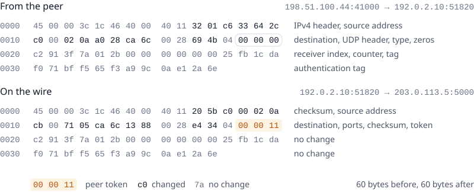
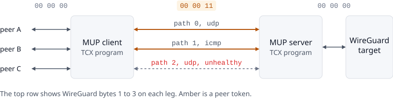
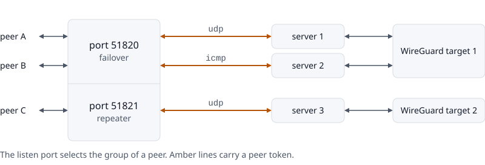
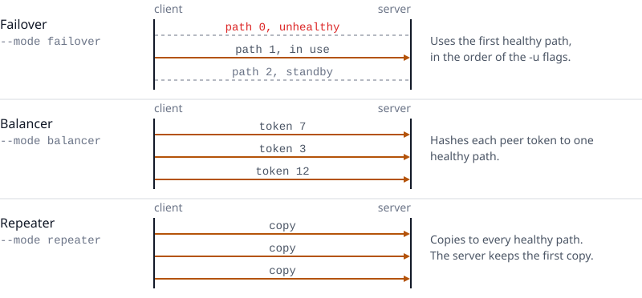
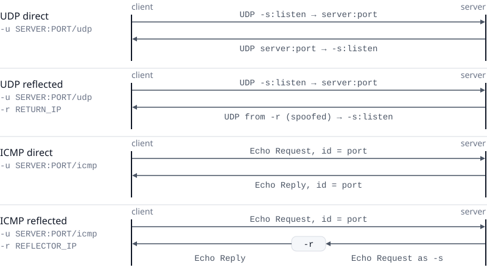

# MUP

MUP carries WireGuard traffic over several UDP or ICMP paths between two Linux hosts. It is for people who run their own WireGuard gateways.

<picture>
  <source media="(prefers-color-scheme: dark)" srcset=".docs/images/packet-dark.svg">
  
</picture>

This is one WireGuard keepalive on a UDP path. The MUP client rewrites it, and the packet keeps its 60 bytes and gets no tunnel header. The amber bytes hold the peer token, a number from 1 to 4095 that identifies the peer. WireGuard still encrypts and authenticates the payload from end to end.

A MUP client and a MUP server attach eBPF programs to the TCX ingress hook of Linux. The programs forward all data packets, and no data packet enters Go. Go runs the control plane: registration, path health, cleanup, and logs. The `mupctl` command shows the state of a running daemon and changes its paths.

## How it works

<picture>
  <source media="(prefers-color-scheme: dark)" srcset=".docs/images/overview-dark.svg">
  
</picture>

Peers send to the MUP client, not to the real WireGuard server. The client gives each peer a peer token and writes it into three bytes that WireGuard always sends as zero. Then it sends the packet to the MUP server on one or more paths. The server clears the token and forwards the packet to the WireGuard target. Replies go back the same way.

If a path stops answering, the client moves traffic away from it. One server can serve many clients, and it forwards all of their traffic to one WireGuard target.

<picture>
  <source media="(prefers-color-scheme: dark)" srcset=".docs/images/groups-dark.svg">
  
</picture>

One client can also serve several WireGuard targets. A path group joins one listen port to the servers of one target. A peer selects its target with the port in its `Endpoint`.

<picture>
  <source media="(prefers-color-scheme: dark)" srcset=".docs/images/modes-dark.svg">
  
</picture>

Each group has one of three path modes. Failover uses the first healthy path. Balancer spreads the peers over the healthy paths. Repeater sends a copy on every healthy path, and the server keeps the first copy that arrives.

<picture>
  <source media="(prefers-color-scheme: dark)" srcset=".docs/images/return-modes-dark.svg">
  
</picture>

Each path has its own return mode. The optional `via RETURN_IP` after a path sets it, and the client `-r` flag sets it for each path without one. Without a return IP, the server replies directly with the transport of the path. On a UDP path, the server sends replies with the return IP as their source. On an ICMP path, the server sends an Echo Request to the return IP, and that host answers the client.

A group can also have separate ingress paths and egress paths, each with its own mode and health. The client picks the ingress path of each packet, and the server picks the egress path of each reply. See [Separate ingress and egress paths](#separate-ingress-and-egress-paths).

A bridge is a second host between a client and a server. It passes the ingress on to the server, and it sends the replies of a server whose network drops spoofed packets. See [Bridges](#bridges).

[PROTOCOL.md](PROTOCOL.md) describes every packet, map, timer, and drop reason.

## Requirements

- Linux 6.6 or later, with TCX and a bpffs mount at `/sys/fs/bpf`
- Root, or the capabilities to load BPF programs, attach TCX links, open raw ICMP sockets, and bind sockets to interfaces
- IPv4 between the peers, the client, the server, and the target
- Go 1.27.3 or later to build, and clang/LLVM to change the BPF code

MUP does not attach XDP programs, and it has no fallback to legacy TC.

## Install

The release images are at `ghcr.io/xshecan/mup`. Each image has `mup` and `mupctl`, and its entry point is `mup`.

```sh
docker pull ghcr.io/xshecan/mup:latest
```

To use the Go packages in another module, add this module:

```sh
go get github.com/xshecan/mup@latest
```

## Quick start

The example uses one client host, one server host with two addresses, and a WireGuard server at 198.51.100.7.

1. Build the daemon and `mupctl`:

   ```sh
   go build ./cmd/mup
   go build ./cmd/mupctl
   ```

2. On the server host, start the server:

   ```sh
   sudo ./mup server -p 5000 -r 198.51.100.7:51820
   ```

3. On the client host, start the client with one UDP path and one ICMP path. The address 192.0.2.10 must be an address of the client host.

   ```sh
   sudo ./mup client -p 51820 \
     -u 203.0.113.5:5000/udp \
     -u 203.0.113.6:5000/icmp \
     -s 192.0.2.10
   ```

4. In the configuration of each WireGuard peer, set `Endpoint` to the client host and port 51820.

5. On the client host, make sure that the paths are healthy:

   ```sh
   sudo ./mupctl status
   ```

The WireGuard server then sees the MUP server as the endpoint of each peer. WireGuard accepts the new endpoint, because it authenticates each packet and not the address.

## Configuration file

The flags of the daemon configure one server, or one client with one group. A YAML file can do the same, and it can configure more groups. In the file, the list `servers` holds the groups, and the list `routes` of each entry holds its paths. The file selects the role. The directory `configs` has one example for each role.

```sh
sudo ./mup --config configs/client.yaml
```

```yaml
client:
  advertise: 192.0.2.10
  servers:
    - port: 51820
      mode: failover
      routes:
        - 203.0.113.5:5000/udp
        - 203.0.113.6:5000/icmp
    - port: 51821
      mode: repeater
      routes:
        - 198.51.100.20:6000/udp via 1.1.1.1
        - 198.51.100.20:6000/icmp via 9.9.9.9
```

```yaml
server:
  port: 5000
  target: 198.51.100.7:51820
```

| Key | Flag | Meaning |
| --- | --- | --- |
| `client.advertise` | `-s` | The advertised IP. |
| `client.control_socket` | `--control-socket` | Optional. The socket for `mupctl`. An empty value turns the socket off. |
| `client.servers[].port` | `-p` | The port where the group receives packets from its peers. |
| `client.servers[].mode` | `--mode` | Optional. The path mode of the group. The default is `failover`. |
| `client.servers[].ingress`, `client.servers[].egress` | `--ingress`, `--egress` | Optional. A `mode` and `routes` for each direction, in place of `mode` and `routes`. See [Separate ingress and egress paths](#separate-ingress-and-egress-paths). |
| `client.servers[].ingress.bridges`, `client.servers[].egress.bridges` | `--ingress-bridge`, `--egress-bridge` | Optional. The paths through a bridge in each direction. See [Bridges](#bridges). |
| `client.servers[].routes` | `-u` | The paths of the group, in the form of the `-u` flag. A path can end with `via RETURN_IP`. The server port of a path can be a range, `FIRST-LAST`. See [Server port ranges](#server-port-ranges). |
| `server.port` | `-p` | The UDP ports and the ICMP Echo identifiers that the server accepts, as `PORT` or `FIRST-LAST`, for example `5000-6000`. |
| `server.target` | `-r` | The WireGuard target that receives all traffic. |
| `server.control_socket` | `--control-socket` | Optional. The socket for `mupctl`. An empty value turns the socket off. |
| `server.target_ingress` | `--target-ingress` | Optional. Delivers each packet into the ingress hook of the interface that holds the target address, from the advertised IP of the client. Use it for a target on the server host with its own TC program on that interface. An example is a WireGuard router with an eBPF fast path. |
| `bridge.server` | `-s` | The MUP server of a bridge. |
| `bridge.port` | `-p` | The UDP ports and the ICMP Echo identifiers that the bridge takes, as `PORT` or `FIRST-LAST`. |
| `bridge.allow` | `-a` | Optional. More source ranges of the server, as IPv4 CIDRs, for a server behind NAT. |
| `bridge.control_socket` | `--control-socket` | Optional. The socket for `mupctl`. The default is `/run/mup/bridge.sock`. An empty value turns the socket off. |

The daemon does not start with an unknown key in the file. A value can use `${VARIABLE}`, or `${VARIABLE:default}` with a default value.

## Server port ranges

A filter on the network can drop the packets of one flow and pass the packets of the other flows. A path then gets no ACK on its server port, but another server port of the same server gets through. To let the client move such a path, give its route a range of server ports:

```yaml
routes:
  - 203.0.113.5:5000-5499/udp via 94.184.45.48/28
  - 203.0.113.5:5500-5999/udp via 194.225.72.0/28
  - 203.0.113.5:5000-5999/icmp via 94.184.45.48/28
```

The path starts on the first port of its range. If 10 REGISTER frames in a row get no answer, the client moves the path to a random other port of the range. The log shows the move. Each move without an answer doubles the wait for the next move, up to 16 times the first wait. An answer resets the wait. A server answer without a healthy reflector is an answer, so it does not move the path.

These rules apply to port ranges:

- The range must be inside the server ports, `server.port`, because the server ignores the other ports.
- The ranges of two routes to the same server with the same transport and interface must not share a port.
- The routes of two groups must not share a port of the same server.
- The client does not save a move. At the next start, each path starts on the first port of its range again.

## Separate ingress and egress paths

A path carries both directions: the server sends each reply back on the path of the latest ingress packet. To let each direction pick its own path, give the group an `ingress` block and a `egress` block instead of `mode` and `routes`:

```yaml
client:
  advertise: 192.0.2.10
  servers:
    - port: 51820
      ingress:
        mode: failover
        routes:
          - 203.0.113.5:5000-5099/udp
          - 203.0.113.5:5100/icmp
      egress:
        mode: balancer
        routes:
          - 203.0.113.5:5200/icmp via 198.51.100.0/28 per-packet
          - 203.0.113.6:5300/udp
```

The client picks the ingress path of each packet with the ingress mode. The server picks the egress path of each reply with the egress mode. An egress path that fails moves only the replies, and an ingress path that fails moves only the ingress.

An egress route has the form of a path, with these differences:

- `SERVER` is an address of the server host. A direct egress path sends the replies from it, and the server sends through the interface that holds it.
- `PORT` is one port of `server.port`. It is the UDP source port of the replies, or the identifier of ICMP replies.
- `via` is optional, as in a path. The server reflects the replies through the return IP or the pool.
- An egress route has no `%IFACE` and no port range.

An ingress route can take a `via`, which reflects the ingress to the server. See [Ingress reflect](#ingress-reflect). A client has up to 8 ingress paths and up to 8 egress paths in all groups.

The server probes each egress path every 2 seconds, through each member of a pool, and the client answers on an ingress path. An egress path, or a member of its pool, is healthy while these probes come back. So a reflector that answers the ping of the server but does not reach the client carries no replies. The server also sends each ACK on the egress paths, so an ingress path stays healthy even with no packet back on its own flow.

In the egress repeater mode, the server sends each reply on every healthy egress path, and the client passes the first copy to the peer. A server without egress path support ignores the egress paths, and its replies come back on the ingress paths.

### Ingress reflect

A `via` on an ingress route reflects the path, in the other direction from an egress route. The client sends the ingress to the via host, and the via host passes it to the server. So the server never sees the client address on the ingress, only the via host.

```yaml
      ingress:
        routes:
          - 160.119.74.88:9000/icmp via 6.7.8.9
          - 160.119.74.88:9100/icmp via 87.107.117.192/28 per-packet
          - 160.119.74.88:9200/udp via 194.225.72.10
```

These rules apply:

- An ICMP ingress route reflects. The client sends an Echo Request to the via host, with the server as the source. The via host then answers the server with an Echo Reply, and the server accepts the reply as the ingress.
- A UDP ingress route forges the source. The client sends to the server with the via as the source, because a plain host does not reflect a UDP packet.
- `via BASE/PREFIX`, with an optional `per-peer` or `per-packet` after it, reflects through a pool, as an egress route does. The default is `per-peer`.
- A `via` on an ingress route is valid only in a group with `ingress` and `egress`. A symmetric route in `routes` keeps the return meaning of `via`.

The client sends each REGISTER reflected through every member, so the server registers one path for each member that reflects. The client keeps the members whose ACK comes back, and spreads the ingress over them. A member that stops reflecting loses its registration and drops out, so the path carries no ingress through a dead member.

The client must send a packet whose source is not the client address, which is the same spoofing that a reflected egress path needs. An old server rejects an ingress reflect REGISTER, so the path stays unhealthy.

## Bridges

A bridge is a second host between a client and a server. It runs `mup bridge`, and it serves one MUP server. The network of the bridge must accept packets with a source address that is not its own.

- An ingress bridge takes the packets of the client, in the same way as a server. It changes only the destination to its server, and it keeps the client address as the source. So the server gets the same packets as from the client, and it needs no change.
- An egress bridge sends the replies of the server. The server builds each reply as for an egress route, wraps it in a UDP packet, and sends it to the bridge. The bridge removes the wrapper and sends the reply with the source that the egress path needs. So a server whose network drops spoofed packets can use reflected egress paths.

Only the client configuration names a bridge, in a `bridges` list next to `routes` in `ingress` or `egress`. In this example, the server cannot spoof, so the bridge 5.6.7.8 reflects its replies through the pool:

```yaml
client:
  advertise: 160.119.74.74
  servers:
    - port: 51820
      ingress:
        routes:
          - 46.102.130.95:9000/icmp
      egress:
        bridges:
          - 5.6.7.8:9200/icmp via 87.107.117.192/28
```

```yaml
bridge:
  server: 46.102.130.95
  port: 9000-9399
```

A bridge entry has the form of a route, with the bridge address in place of the server address. These rules apply:

- An ingress bridge has no `via`. It can have a port range and `%IFACE`.
- An egress bridge can have `via`. It has one port and no `%IFACE`. Without `via`, it sends the replies from the bridge address.
- The routes and the bridges of a direction share its 8 path slots, and the routes come first. So in the failover mode, a healthy route carries the traffic before a bridge.
- The `port` range of the bridge must include the ports of all bridge entries. The bridge sends the ingress to its server on the same port.

The bridge takes wrapped replies only from its server. A server behind NAT reaches the bridge from its NAT address, so put that address in `bridge.allow`. The bridge passes every other packet to the kernel, so a normal ping to the bridge still gets its reply.

An egress bridge starts unhealthy, because a client does not know which server a bridge serves. Each server that gets the egress bridge probes it, and only the probes of the server of the bridge come back. A dead bridge makes its ingress paths and its egress paths unhealthy.

The wrapper adds 20 bytes to each reply between the server and the bridge. The largest WireGuard message on an egress bridge is thus the path MTU minus 48 bytes. At a path MTU of 1500, this is a WireGuard MTU of 1420, the WireGuard default. The server drops a larger reply and counts reason 25 (`BRIDGE_SIZE`). The ingress through a bridge has no wrapper.

The bridge host needs IPv4 forwarding (`net.ipv4.ip_forward=1`), because the bridge program uses the route lookup of a forwarded packet. Without it, the bridge does not start.

## Several WireGuard targets

To reach several WireGuard targets from one client, do these steps:

1. For each target, start one or more MUP servers that forward to that target.
2. In the client configuration file, add one entry under `servers` for each target. Add the routes to the servers of that target.
3. In the configuration of each WireGuard peer, set the port in `Endpoint` to the listen port of its group.

These rules apply to groups:

- All servers of a group must forward to the same target, because a WireGuard handshake fails against another identity.
- A server address and port can be in one group only.
- Two groups can use the same server host, through different ports or different addresses of it. The server keeps the listen port of each path, so each group gets its replies on its own paths. Both groups then reach the target of that server. This needs a server of v0.4.6 or later.
- All groups share the 8 paths and the 4095 peers of a client.
- If no path of a group is healthy, its peers have no path. MUP does not move them to another group, because that group leads to another target.

## Docker Compose

The file `compose.yaml` runs one role on each host, and a profile selects the role. Each role reads its [configuration file](#configuration-file) from the directory `configs`. The container uses the host network, because TCX attaches to the interfaces of the host. It runs in privileged mode, because the daemon loads BPF programs and writes pins under `/sys/fs/bpf`. The image has both `mup` and `mupctl`.

1. In `configs/server.yaml` and `configs/client.yaml`, replace the example addresses with your addresses.

2. On the server host, start the server:

   ```sh
   docker compose --profile server up -d --build
   ```

3. On the client host, start the client:

   ```sh
   docker compose --profile client up -d --build
   ```

4. On the client host, make sure that the paths are healthy:

   ```sh
   docker compose exec client mupctl status
   ```

To run a bridge, put its configuration in `configs/bridge.yaml`, and start it on the bridge host with `docker compose --profile bridge up -d --build`.

Do not use `docker compose down` to remove MUP from a host. The TCX links stay attached after the container stops, and they keep forwarding with the last state. To remove MUP, stop the container and do the steps in [Restart and removal](#restart-and-removal).

## Command reference

The command `mup --config FILE` reads a [configuration file](#configuration-file). The flags below configure the daemon without a file.

### Client

```text
mup client -p LISTEN_PORT -u "SERVER_IP[%IFACE]:PORT[-LAST]/udp|icmp [via RETURN_IP]" [-u ...] -s CLIENT_IP
           [-r RETURN_IP] [--mode failover|balancer|repeater] [--control-socket PATH]
mup client -p LISTEN_PORT --ingress "SERVER_IP[%IFACE]:PORT[-LAST]/udp|icmp" [--ingress ...]
           --egress "SERVER_IP:PORT/udp|icmp [via RETURN_IP]" [--egress ...] -s CLIENT_IP
           [--ingress-bridge "BRIDGE_IP[%IFACE]:PORT[-LAST]/udp|icmp"] [--ingress-bridge ...]
           [--egress-bridge "BRIDGE_IP:PORT/udp|icmp [via RETURN_IP]"] [--egress-bridge ...]
           [--ingress-mode MODE] [--egress-mode MODE] [--control-socket PATH]
```

| Flag | Value | Meaning |
| --- | --- | --- |
| `-p` | port | The UDP port where the client receives WireGuard packets from the peers. |
| `-u` | `SERVER_IP[%IFACE]:PORT/udp` or `/icmp`, then optionally `via RETURN_IP` | One path to a server. Repeat the flag for up to 8 paths. The optional `%IFACE` binds the path to one interface. The optional `via RETURN_IP` sets the return IP of the path. `PORT` can be a range `FIRST-LAST`, see [Server port ranges](#server-port-ranges). |
| `-s` | IPv4 | The advertised IP. It must be an address of the client host, and no other active client of the server can use it. |
| `-r` | IPv4 | Optional. The return IP of each `-u` path without its own `via`. On UDP paths, it is the spoofed source of replies. On ICMP paths, it is the reflector host. |
| `--mode` | `failover`, `balancer`, `repeater` | The path mode. The default is `failover`. |
| `--ingress` | `SERVER_IP[%IFACE]:PORT/udp` or `/icmp` | One ingress path of a group with separate egress paths. Use it with `--egress`, and not with `-u`. |
| `--egress` | `SERVER_IP:PORT/udp` or `/icmp`, then optionally `via RETURN_IP` | One egress path. See [Separate ingress and egress paths](#separate-ingress-and-egress-paths). |
| `--ingress-bridge`, `--egress-bridge` | `BRIDGE_IP:PORT/udp` or `/icmp` | One ingress path or egress path through a bridge. An egress bridge can end with `via RETURN_IP`. See [Bridges](#bridges). |
| `--ingress-mode`, `--egress-mode` | `failover`, `balancer`, `repeater` | The ingress mode and the egress mode. The default is `failover`. |
| `--control-socket` | path | The socket for `mupctl`. The default is `/run/mup/client.sock`. An empty value turns the socket off. |

### Server

```text
mup server -p PORT[-LAST] -r TARGET_IP:TARGET_PORT [--target-ingress] [--control-socket PATH]
```

| Flag | Value | Meaning |
| --- | --- | --- |
| `-p` | port or range | The UDP ports and the ICMP Echo identifiers that the server accepts, as `PORT` or `FIRST-LAST`. |
| `-r` | IPv4:port | The WireGuard target that receives all traffic. |
| `--target-ingress` | | Optional. Delivers each packet into the ingress hook of the target interface. See the `server.target_ingress` key. |
| `--control-socket` | path | The socket for `mupctl`. The default is `/run/mup/server.sock`. An empty value turns the socket off. |

There are no authentication keys. WireGuard authenticates the payload end to end.

### Bridge

```text
mup bridge -s SERVER_IP -p PORT[-LAST] [-a CIDR] [-a ...] [--control-socket PATH]
```

| Flag | Value | Meaning |
| --- | --- | --- |
| `-s` | IPv4 | The MUP server of the bridge. |
| `-p` | port or range | The UDP ports and the ICMP Echo identifiers that the bridge takes, as `PORT` or `FIRST-LAST`. |
| `-a` | IPv4 CIDR | Optional. One more source range of the server. Repeat the flag for more ranges. |
| `--control-socket` | path | The socket for `mupctl`. The default is `/run/mup/bridge.sock`. An empty value turns the socket off. |

## mupctl

`mupctl` talks to a running daemon over its control socket. It works in the style of kubectl. It shows the health of the paths, the connected peers, and the drop counters. On a client, it also adds and removes paths and changes the path mode of a group.

| Command | Role | What it does |
| --- | --- | --- |
| `mupctl status` | all | Shows an overview. A client lists its groups and paths, and a server lists its clients. A bridge shows its server and the packets that it sent in each direction. |
| `mupctl groups` | client | Lists the groups with their mode, healthy paths, and peers. |
| `mupctl paths` | client | Lists the paths with their server port, return IP, state, the age of the last answer, and round-trip time. With `-o wide`, it also shows the port range, the priority, and the missed ACKs. |
| `mupctl peers` | both | Lists the WireGuard peers of a client, or the peer routes of a server. |
| `mupctl clients` | server | Lists the registered clients with their paths, peers, and lease. |
| `mupctl reflectors` | server | Lists the members of the return pools and their health. |
| `mupctl drops` | all | Lists the nonzero drop counters. |
| `mupctl reset drops` | all | Sets every drop counter to zero. The counters also start from zero at each new map, for example after an upgrade that changes their layout. |
| `mupctl add path SERVER[%IFACE]:PORT[-LAST]/udp [via RETURN_IP]` | client | Adds a path to a group. The value uses the form of the `-u` flag. |
| `mupctl delete path ID` | client | Removes a path. |
| `mupctl set mode repeater` | client | Changes the path mode of a group to `failover`, `balancer`, or `repeater`. |
| `mupctl add path --egress SERVER:PORT/udp [via RETURN_IP]` | client | Adds an egress path to a group with separate egress paths. `delete path --egress ID` removes one, and `set mode --egress MODE` changes the egress mode. |
| `mupctl add path --bridge BRIDGE:PORT/udp` | client | Adds an ingress path through a bridge. With `--egress`, it adds an egress path through a bridge. `delete path` removes either one. |

On a client, `mupctl status` prints this overview:

```text
$ sudo mupctl status
Role:     client
IP:       192.0.2.10
Uptime:   3h12m
Paths:    2/3 healthy, generation 7
Peers:    3
Tokens:   3/4095
Drops:    37 (NO_PATH 30, WG_LENGTH 7)

GROUP   MODE       PATHS         PEERS
51820   failover   2/2 healthy   2
51821   repeater   0/1 healthy   1

ID   GROUP   SERVER               TRANSPORT   VIA       INTERFACE   STATE       SEEN        RTT
0    51820   203.0.113.5:5000     udp         -         eth0        active      4s ago      12.3ms
1    51820   203.0.113.6:5000     icmp        -         eth1        standby     7s ago      18.7ms
2    51821   198.51.100.20:6000   udp         1.1.1.1   eth2        unhealthy   2m10s ago   64.1ms
```

The STATE column joins the health of a path and its use. A healthy path is `active` while its group sends traffic on it, and `standby` while it waits. In failover mode, only the first healthy path of the group is active. The SEEN column shows the age of the last answer of the server. The RTT column shows the time from a REGISTER to its ACK. For an egress path, the time starts with a REGISTER on the active ingress path of the group. It ends when the ACK arrives on that egress path.

```text
$ sudo mupctl peers
TOKEN   PEER                  LOCAL              INTERFACE   IDLE
1       198.51.100.44:41000   192.0.2.10:51820   eth0        2s
2       198.51.100.45:39112   192.0.2.10:51820   eth0        14s
3       203.0.113.90:51820    192.0.2.10:51821   eth0        1m35s
```

A peer counts as connected until it is idle for 180 seconds. Then its route expires.

These flags work with every command:

- `-o wide` adds columns, for example the priority and missed ACKs of each path.
- `-o json` prints the raw API response.
- `-w` shows the output again every second. It works with `status` and the list commands.

Each list command also works after `get`, for example `mupctl get paths`, as in earlier versions.
- `--socket PATH` selects the daemon. Without it, `mupctl` uses `$MUP_SOCKET`, then the one default socket that exists.
- `--group LISTEN_PORT` selects the group for `add path` and `set mode`. A client with one group does not need it.

These rules apply to path changes:

- A new path stays unhealthy until the server answers its first REGISTER. This usually takes less than one second.
- A client has at most 8 paths in all groups.
- `mupctl` does not remove the last path of a group. Add the new path first.
- `mupctl` does not add or remove groups. To change the groups, edit the configuration file and restart the daemon.
- The changes last until the daemon restarts. The daemon then uses its flags or its configuration file again.

Run `mupctl` as root. The daemon creates the socket at each start, with mode 0660 and root as the owner.

## Logs

The daemon does not log counters. Use `mupctl status` or `mupctl drops` to read them, and `mupctl reset drops` to set them to zero. The daemon logs an event for an empty pool of tokens or ports. It also logs an event for a forward route entry that disagrees with its reverse entry. Each of these reasons logs at most 10 events per minute. The logs never contain payloads or peer addresses.

The [drop reason table](PROTOCOL.md#drop-reasons) explains each counter.

## Restart and removal

If you restart MUP, keep the pin directory. The new process reuses the pinned maps and replaces the programs in the pinned TCX links, so forwarding does not stop.

The TCX links stay attached after the process stops, and they keep forwarding with the last state. To remove MUP from a host, do these steps:

1. Stop the process.
2. Delete the pin directory of the role, `/sys/fs/bpf/mup/client` or `/sys/fs/bpf/mup/server`:

   ```sh
   sudo rm -r /sys/fs/bpf/mup/client
   ```

If a new version of MUP changes a map layout, the load fails with the old pins. Delete the pin directory before you start the new version.

## Build

The Go package embeds the generated BPF objects:

```sh
go generate ./dataplane
go test ./...
go build ./cmd/mup
go build ./cmd/mupctl
```

Generation requires clang/LLVM. A build from a checkout that already has the generated objects does not.

The diagrams come from one Python script that uses only the standard library. To change a diagram, edit the script and render the SVG files again:

```sh
python3 .docs/render_diagrams.py
```

## Linux qualification

Run the privileged verifier and namespace tests on the deployment kernel before production use:

```sh
sudo -E go test ./dataplane -count=1 -v
sudo -E env MUP_PRIVILEGED_TESTS=1 go test ./integration -count=1 -v
```

The dataplane tests load both programs into the kernel. `TestVerifierComplexity` logs how many instructions the verifier processed for each program, and the kernel limit is one million.

The integration tests create disposable network namespaces and private bpffs mounts. They do not touch the interfaces or the pins of the host. They cover these cases:

- UDP and ICMP round trips in the direct and reflected modes.
- Two groups that lead to two WireGuard targets.
- The repeater, failover, and balancer modes, and a failover after a server stops.
- A target on the server host, on the loopback address and on another address.
- The limit of routes for one source IP.
- A normal ping with the server port as its identifier.
- Separate ingress and egress paths: a failover of the egress paths only, and an egress repeater.
- A bridge for the ingress and for a reflected egress, with a server that cannot spoof, and the failure and return of the bridge.

These tests pass on Linux 6.8 (Ubuntu 24.04) and on Linux 6.12 (Debian 13). To run them with a daemon that you built before, set `MUP_BINARY` to its path. To measure real PPS, bandwidth, drops, and CPU, use the namespace topology with the production NICs.

macOS can compile the Linux code, but it cannot load the programs or run the privileged tests.

## Security

MUP has no authentication of its own. A host can spoof the source address of a registered client. That host can then register paths for the client, change its return mode, and drop or misroute its traffic. That host cannot read or forge WireGuard payloads, because WireGuard authenticates them end to end. Use MUP only on networks where you control the hosts and the routing.

## Limits

- IPv4 only, with no IPv4 options and no fragments.
- Up to 8 paths, up to 8 egress paths, and up to 4095 peers per client, shared by all of its groups. The bridges of a direction count as its paths.
- A reply on an egress bridge is 20 bytes larger between the server and the bridge. At a path MTU of 1500, it needs a WireGuard MTU of 1420 or less.
- Up to 1024 peers from one source IP on a client.
- Up to 41000 routes per server, and up to 4096 registered clients.
- Up to 4096 server ports in one range. The server opens one UDP socket for each port, so no other program can use a port of the range. A packet to a port of the range from a registered path must be valid MUP traffic, or the server drops it. Every other UDP packet to these ports goes on to the kernel, for example the replies of a NAT flow on such a port.
- A UDP packet with a checksum of zero gets a computed checksum. Some NAT devices write zero where RFC 768 requires 0xffff. If such a packet has a payload longer than 9216 bytes, MUP drops it.
- The target can be on the server host, on `127.0.0.1` or on another address of the host. On a UDP path, the network device then completes the checksum of each reply. On an ICMP path, MUP computes the checksum itself, because some devices, for example vmxnet3, do not complete it for ICMP. A device that completes it can still change the Echo sequence field, so these replies have no fixed sequence.
- On an ICMP route with `via`, the server reaches the `via` host only through the interface that faces the client.
- A client binds a UDP control socket to its advertised IP and each listen port. If another program holds that port, the client does not start.
- MUP attaches only to the interfaces that are ingress at start. After you add an interface, restart MUP.
- MUP supports only interfaces with an Ethernet header, and the loopback interface. A path over a PPP, tun, WireGuard, or raw-IP modem interface fails at start.
